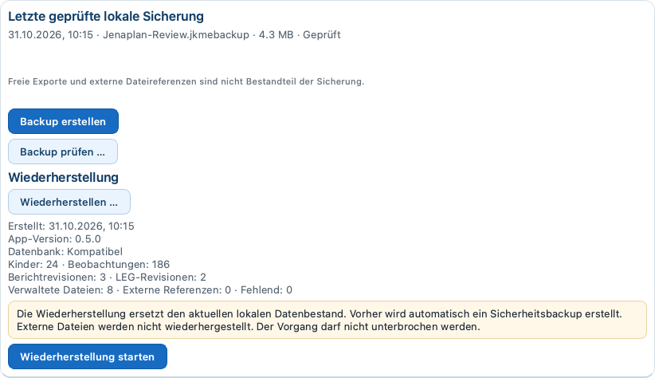

# Backup und Wiederherstellung

Stand: 1. November 2026
Version {{PILOT_VERSION}} / Build {{PILOT_BUILD}}

## Was gesichert wird

Unter `Einstellungen > Datensicherung` erstellt die App ausschließlich ein
verschlüsseltes, authentisiertes `.jkmebackup`. Es umfasst die verschlüsselte
Fachdatenbank, den Dokument-Companion, die registrierten verschlüsselten
Managed Documents und notwendige Schlüsselmetadaten. Der aktive V4- oder
V7-Stand wird über seinen jeweils passenden Backupvertrag gesichert.

App-Passwort, Recovery-Codes, Touch-ID-/Geräteanmeldedaten und der lokale Data
Master Key (DMK) sind nicht enthalten. Externe Originaldateien, die außerhalb
des verwalteten App-Bestands liegen, werden nicht mitgesichert. Auch eine
bewusst exportierte Kompetenzübersicht benötigt dort eigenen Schutz.

> [!SICHERHEIT]
> Ein Backup ist weiterhin an die ursprüngliche geschützte Installation und
> den vorhandenen lokalen Schlüsselkontext gebunden. Es ersetzt weder einen
> verlorenen DMK noch das verlorene Gerät. Es ist kein allgemeiner
> Gerätewechselweg. Recovery-Codes getrennt vom Mac aufbewahren.

## Backup erstellen und gesondert prüfen

1. Laufende Bearbeitungen speichern und `Einstellungen > Datensicherung` öffnen.
2. `Backup erstellen` wählen und den gewünschten Zielordner auswählen.
3. Den Vorgang bis zur Meldung `Die Sicherung wurde erstellt und geprüft.`
   abwarten. Zeitpunkt und Speicherort kontrollieren.
4. Danach mit `Backup prüfen …` dieselbe `.jkmebackup`-Datei erneut auswählen.
   Die Meldung `Die Sicherung wurde geprüft.` abwarten.
5. Eine Kopie nach schulischer Vorgabe an einem geschützten, vom laufenden
   Mac getrennten Sicherungsort aufbewahren. Für den Restore muss der
   ursprüngliche Schlüsselkontext trotzdem verfügbar bleiben.

Die gesonderte Prüfung liest und verifiziert das vorhandene Backup erneut.
Sie verändert den aktiven Fachbestand nicht. Ein Dateiname oder eine
Dateigröße allein ist kein erfolgreicher Prüfnachweis. Ein fehlgeschlagener
Versuch darf nicht als neue Sicherung gezählt werden.

Die App erinnert anhand vorhandener geprüfter lokaler Sicherungen an deren
Alter. Daraus folgt keine automatische Sicherung oder Aufbewahrungsautomatik.
Sichern und prüfen Sie regelmäßig und insbesondere vor Update, Migration oder
einem betreuten Wiederherstellungsvorgang.

## Wiederherstellung innerhalb desselben Schemas

1. Laufende Bearbeitungen speichern. `Einstellungen > Datensicherung` öffnen.
2. `Wiederherstellen …` wählen und die gewünschte `.jkmebackup`-Datei auswählen.
3. Die Vorschau prüfen: Erstellungszeit, App-Version, Kompatibilität sowie
   Anzahlen von Kindern, Beobachtungen, Revisionen und verwalteten Dateien.
4. Nur bei passendem Bestand den angebotenen Wiederherstellungsstart wählen
   und die Sicherheitsabfrage bewusst mit `Wiederherstellen` bestätigen.
5. Den Vorgang bis zur vollständigen App-Beendigung und zum kontrollierten
   Neustart laufen lassen. Keine zweite Instanz starten.
6. Erneut anmelden und den wiederhergestellten Arbeitsstand prüfen.

Die App prüft den vollständigen Backupinhalt in einem neuen getrennten
Staging-Bereich. `Sicher zur Wiederherstellung vorbereitet (RESTORE_READY)`
bezeichnet einen vollständig vorbereiteten Stand, noch keinen bereits
ausgeführten Restore. Vor dem Austausch erstellt die App ein verschlüsseltes
Sicherheitsbackup des bisherigen Livebestands. Ein separater Worker darf den
Austausch erst nach der kontrollierten App-Beendigung übernehmen. Der Neustart
prüft den neuen Bestand erneut; eine Anmeldung ist erforderlich.

Der Restore ersetzt den aktuellen Fachbestand durch den Sicherungszeitpunkt.
Nicht gespeicherte Bearbeitungen in geöffneten Fenstern werden verworfen.
Das vorhandene App-Konto und sein Passwort werden aus diesem Fachbackup nicht
zurückgesetzt. V7-Backups verlangen den passenden V7-Restorevertrag; V4-Backups
sind keine direkt einspielbaren V7-Sicherungen.

## Update von Build 404 oder 405 auf 0.5.1 / Build 406

Vor dem Update eine vollständige verschlüsselte `.jkmebackup` erstellen und gesondert prüfen. Die Sicherung geschützt erhalten.

Nach dem Update über den bestehenden Pilotkanal erkennt Build 406 einen vorhandenen Final-V4-Bestand automatisch. Melden Sie sich mit Ihrem bisherigen Passwort an. Der Dialog `Datenbestand aktualisieren` erklärt Sicherung, Umstellung und Rückkehrgrenze. Lesen Sie die Hinweise, setzen Sie `Ich möchte die Aktualisierung jetzt starten.` und wählen Sie `Aktualisierung starten`. Mit `Später` verschieben Sie die Umstellung; es wird nichts migriert.

Die App erstellt eine vollständige verschlüsselte V4-Sicherung und prüft sie unabhängig. Erst danach folgt die kontrollierte Umstellung nach V7. Lassen Sie den Mac eingeschaltet und starten Sie keine zweite App. Die Anzeige nennt die tatsächlichen Phasen; es gibt keine Prozentprognose. Nach vollständiger Zielprüfung startet die App regulär neu. Melden Sie sich mit dem bisherigen Passwort an und prüfen Sie Ihre Daten. Bereits vollständig aktualisierte V7-Bestände werden nicht erneut migriert.

Bei einem Fehler bleiben Bestand, Sicherungen und Wartungsbelege erhalten. Notieren Sie Version/Build, Zeitpunkt, Handlung und den personenfreien Supporthinweis. Wenden Sie sich an die Pilotbetreuung; senden Sie keine Passwörter, Recovery-Codes, Schlüssel oder Schülerdaten ungeschützt. Nur wenn die App `Abschluss prüfen` anbietet, kann dieser bewusst bestätigt werden. Keine Dateien löschen, keinen neuen Bestand anlegen und keine alte App als Reparatur starten. Terminalbefehle sind für Lehrkräfte nicht erforderlich.

Nach erfolgreichem Neustart Kinder, Zuordnungen, Beobachtungen, Bewertungen, Dokumente, Berichte/LEG und Stundenplan prüfen. Ein neues V7-Backup erstellen und prüfen. Die vollständige V4-Quellsicherung bleibt Rückfallquelle. V4- und V7-Backups sind nicht austauschbar. Der technische Wartungsaufruf ist ausschließlich in der macOS-Supportanleitung beschrieben.

> [!WARNUNG]
> Build 404 kann eine V7-Datenbank nicht öffnen. Ein Downgrade ist nicht durch
> einfaches Neuinstallieren von 404 möglich. Eine betreute Rückkehr zu V4
> erfordert eine geeignete vollständige V4-Sicherung im ursprünglichen
> Installations- und Schlüsselkontext. Alle Änderungen seit deren
> Sicherungszeitpunkt können dabei verloren gehen.

Keine einzelne Hauptdatenbank zurückkopieren und kein V4-Backup direkt in
eine aktive V7-Installation einspielen. Ein allgemeiner Rückmigrationsassistent
ist nicht vorhanden.

## Wenn Backup oder Restore scheitert

Eine nicht akzeptierte Datei nicht umbenennen oder entpacken, um die Prüfung
zu umgehen. Prüfen Sie zunächst sicher selbst, ob die richtige Datei aus der
eigenen Installation ausgewählt und ihr Speicherort erreichbar ist. Bei
Platzmangel nur außerhalb des geschützten App-Datenbereichs nach Schulvorgabe
Platz schaffen. Danach einen neuen regulären Versuch über die App starten.

Bei gemeldeter Beschädigung, falschem Schema oder Schlüsselkontext, einem
unvollständigen Upgrade oder fehlgeschlagenem Worker-/Neustart ist die
Betreuung erforderlich. Meldung und technische Kennung ohne Schülerdaten
festhalten. Originalbestand, Backup und vorhandene Belege erhalten.

Bei einem Fehler vor Workerübernahme bleibt der Livebestand unverändert.
Nach Beginn eines Austauschs entscheidet der vorhandene
Rollback-/Recoveryvertrag über den sicheren Zustand. Wenn kein eindeutiger
Zustand nachgewiesen ist, hält die App an. Es gibt keine Zusage einer
vollautomatischen Reparatur nach jedem Abbruch. Keine Staging-, WAL-/SHM-,
Journal-, Quellbackup- oder Abschlussdateien manuell löschen und keinen
Migrationsaufruf blind wiederholen.

## Passwort-Recovery und Supportgrenze

Bei verlorenem Passwort zuerst `Recovery-Code verwenden` nutzen. Ein solcher
Code stellt den Kontozugang wieder her, keinen verlorenen Datenschlüssel.

Ein betreuter Support-Reset ist nur für eine noch nicht umgestellte,
vollständig intakte V4-Installation vorgesehen: vorhandener zugänglicher DMK,
vollständig prüfbarer V4-Bestand und erfolgreich erzeugtes sowie verifiziertes
Safety-Backup sind zwingend. Er verändert weder Fachdaten noch Datenschlüssel.
Für V7 ist dieser V4-spezifische Support-Reset nicht verfügbar. Ohne nutzbaren
Recovery-Code die Pilotbetreuung hinzuziehen; keine Schlüssel oder Codes
ungeschützt weitergeben.

## Aufbewahrung

Sicherungsfristen und Ablageorte bestimmt die Schule. Gelöschte Beobachtungen
oder Dokumente können in älteren Backups weiter enthalten sein. Die App
löscht diese Sicherungen nicht automatisch und verspricht keine sichere
physische Löschung. Technische Upgrade- und Restorebelege im aktiven
App-Datenbereich nicht eigenständig bereinigen.
