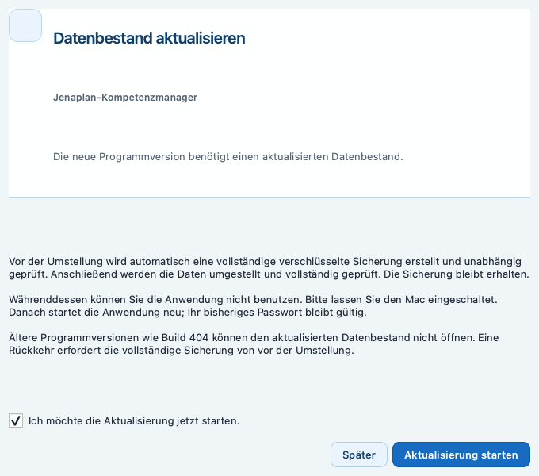

# Installation des Jenaplan-Kompetenzmanagers

Diese Anleitung gilt für die Mac-Pilotversion
{{PILOT_VERSION}} / Build {{PILOT_BUILD}}.

## 1. Voraussetzungen

> [!VORAUSSETZUNG]
> - Mac mit Apple-Prozessor (M1 oder neuer) und macOS 13 oder neuer;
> - genügend freier Speicherplatz für App, lokale Daten und vollständige Sicherungen;
> - die vereinbarte, freigegebene DMG-Datei;
> - beim Update das bisherige App-Passwort und der ursprüngliche lokale Schlüsselkontext.

Die App arbeitet lokal, ohne Cloud und ohne KI-Verarbeitung von Fachdaten.
Fachdaten und verwaltete Dokumente werden lokal verschlüsselt gespeichert.
Eine Datensicherung ersetzt nicht den Zugang zum lokalen Datenschlüssel.

## 2. App installieren

1. Eine laufende App vollständig beenden.
2. Das vereinbarte DMG im Finder öffnen.
3. `Jenaplan-Kompetenzmanager.app` in `Programme` ziehen. Beim Update die
   vorhandene App ersetzen und das Kopieren abwarten.
4. DMG auswerfen und die App aus `Programme` öffnen.
5. Unter `Über die App` Version {{PILOT_VERSION}} und Build {{PILOT_BUILD}}
   prüfen.

Für die normale Benutzung werden Python, Terminal und Repository nicht
benötigt. Die Datenumstellung wird durch den integrierten Assistenten begleitet.

## 3. Gatekeeper kontrolliert freigeben

Der aktuelle Pilot ist ad-hoc signiert und nicht notarisiert. macOS kann den
ersten Start deshalb blockieren.

1. Den macOS-Hinweis schließen.
2. Im Ordner `Programme` mit gedrückter Control-Taste auf die App klicken.
3. `Öffnen` wählen und bestätigen.
4. Falls nötig, unter `Systemeinstellungen > Datenschutz & Sicherheit` nur für
   diese App `Dennoch öffnen` wählen.

> [!WARNUNG]
> Gatekeeper niemals global deaktivieren. Es werden keine Apple-Zugangsdaten,
> Zertifikate oder Kennwörter mitgeliefert. Ad-hoc-Signierung ist keine
> Developer-ID-Signatur oder Apple-Notarisierung.

## 4. Frische Installation und bestehende Anmeldung

Bei einer frischen Installation ein App-Passwort mit mindestens 15 Zeichen
anlegen. Das Passwort schützt den Zugang; der Datenschlüssel ist davon
getrennt und wird über den macOS-Schlüsselbund geschützt. Die zehn einmalig
angezeigten Recovery-Codes getrennt und außerhalb des Macs sicher aufbewahren.

Die App richtet zunächst einen frischen verschlüsselten Final-V4-Bestand ein.
Automatisch vorhanden sind:

- Schuljahr `2026/27` vom 01.08.2026 bis 31.07.2027;
- offizielles Entwicklungsbuch;
- 331 Kompetenzen.

Schüler, Stammgruppen, Kurse, Kursverbünde, Beobachtungen, Bestätigungen,
Berichts-/LEG-Entwürfe, Testdokumente, Beispielbestände und Testbackups werden
nicht angelegt. Ein Katalogimport oder Beispielbestand ist nicht nötig.
Der Migrationsassistent wird nach abgeschlossener Einrichtung beim folgenden
Programmstart angeboten. Eine direkte V7-Erstanlage erfolgt nicht.

Bei einem Update mit dem bisherigen Passwort anmelden. Kein neues Konto,
keinen neuen Datenordner und keinen neuen Datenschlüssel anlegen.

## 5. Update von Build 404 oder 405 auf Build 406

Vor dem Update unter `Einstellungen > Datensicherung` ein vollständiges verschlüsseltes `.jkmebackup` erstellen und mit `Backup prüfen …` prüfen. Nach Veröffentlichung wird Build 406 über die vorhandene Updateprüfung des Pilotkanals angeboten. Die manuelle Installation aus dem freigegebenen DMG bleibt möglich.

Nach dem Update über den bestehenden Pilotkanal erkennt Build 406 einen vorhandenen Final-V4-Bestand automatisch. Melden Sie sich mit Ihrem bisherigen Passwort an. Der Dialog `Datenbestand aktualisieren` erklärt Sicherung, Umstellung und Rückkehrgrenze. Lesen Sie die Hinweise, setzen Sie `Ich möchte die Aktualisierung jetzt starten.` und wählen Sie `Aktualisierung starten`. Mit `Später` verschieben Sie die Umstellung; es wird nichts migriert.

Die App erstellt eine vollständige verschlüsselte V4-Sicherung und prüft sie unabhängig. Erst danach folgt die kontrollierte Umstellung nach V7. Lassen Sie den Mac eingeschaltet und starten Sie keine zweite App. Die Anzeige nennt die tatsächlichen Phasen; es gibt keine Prozentprognose. Nach vollständiger Zielprüfung startet die App regulär neu. Melden Sie sich mit dem bisherigen Passwort an und prüfen Sie Ihre Daten. Bereits vollständig aktualisierte V7-Bestände werden nicht erneut migriert.

Bei einem Fehler bleiben Bestand, Sicherungen und Wartungsbelege erhalten. Notieren Sie Version/Build, Zeitpunkt, Handlung und den personenfreien Supporthinweis. Wenden Sie sich an die Pilotbetreuung; senden Sie keine Passwörter, Recovery-Codes, Schlüssel oder Schülerdaten ungeschützt. Nur wenn die App `Abschluss prüfen` anbietet, kann dieser bewusst bestätigt werden. Keine Dateien löschen, keinen neuen Bestand anlegen und keine alte App als Reparatur starten. Terminalbefehle sind für Lehrkräfte nicht erforderlich.

Synthetische Abbildung der aktuellen Build-406-Oberfläche.

Nach dem Neustart Kinder, Beobachtungen, Kompetenzstände, Dokumente, Stundenplan und Berichts-/LEG-Stände prüfen. Ein neues V7-Backup erstellen und prüfen; die V4-Sicherung erhalten.

> [!WARNUNG]
> Build 404 kann V7 nicht öffnen. Eine Rückkehr benötigt eine vollständige V4-Sicherung im ursprünglichen Schlüsselkontext und technische Betreuung. Änderungen seit der Sicherung können verloren gehen; keine Einzeldateien zurückkopieren.

## 6. Backup, Restore und Unterstützung

Unter `Einstellungen > Datensicherung` mit `Backup erstellen` eine
verschlüsselte `.jkmebackup` anlegen und mit `Backup prüfen …` prüfen.
`Wiederherstellen …` prüft die Sicherung, zeigt eine Vorschau und verlangt
Bestätigung. Danach folgen verifiziertes Staging, Safety-Backup, separater
Worker, vollständige App-Beendigung, kontrollierter Neustart und erneute
Anmeldung. Bei einem Fehler nichts einzeln zurückkopieren und die Betreuung
hinzuziehen.

Backups sind an die ursprüngliche geschützte Installation und deren
vorhandenen lokalen Schlüsselkontext gebunden. Sie können nicht beliebig
auf jedem Mac wiederhergestellt werden und sind kein Cloud-Backup.

Bei verlorenem Passwort `Recovery-Code verwenden` wählen. Support Reset ist
nur vor der V7-Umstellung ein betreuter Ausnahmeweg bei vollständig intaktem
Final V4, zugreifbarem Schlüssel und erfolgreich erzeugtem und geprüftem
Safety-Backup. Für V7 gibt es keinen entsprechenden Support-Resetadapter.
Ein verlorener lokaler Datenschlüssel ist nicht recoverbar.

An die Betreuung zunächst Version/Build, Zeitpunkt, Handlung und den
personenfreien Fehlercode übermitteln. Keine Passwörter, Schlüssel,
Recovery-Codes, personenbezogenen Daten oder vollständigen Backupinhalte
ungeschützt senden. Weitere Fehlerhilfen stehen in der technischen
macOS-Installationsanleitung sowie in der Backup-Anleitung.

## 7. Bekannte Grenzen

> [!HINWEIS]
> - macOS-arm64-Pilot; kein öffentlicher Stable-Release oder Windows-Release;
> - ad-hoc signiert, nicht notarisiert;
> - keine Cloud-Synchronisation oder KI-Funktion;
> - keine automatische V4→V7-Migration;
> - keine allgemeine Geräteportabilität oder Recovery eines verlorenen lokalen Schlüssels;
> - finale Bericht- und LEG-PDFs öffnen read-only im sicheren In-App-Viewer;
>   Export, Drucken und Teilen aus diesem Viewer sind nicht Teil dieses Vertrags.

Die bewusste separate Kompetenzübersicht als PDF ist eine eigene
Exportfunktion. Eine ausgegebene Datei muss außerhalb der App geschützt
aufbewahrt werden.
