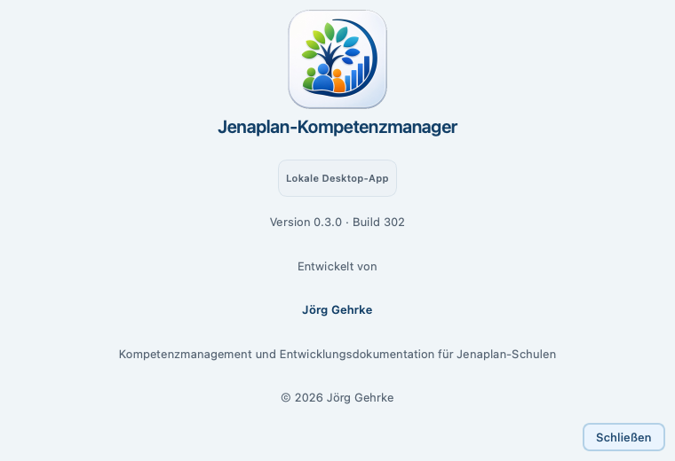
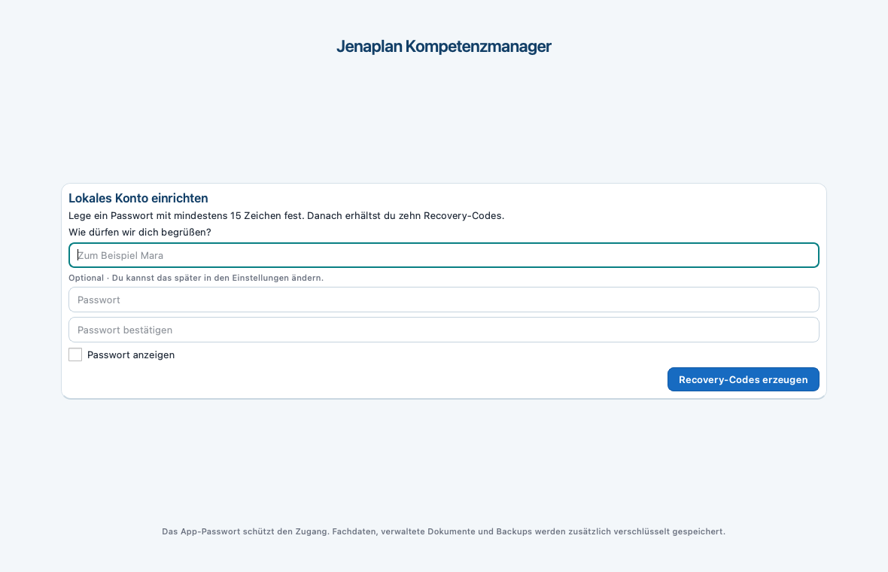
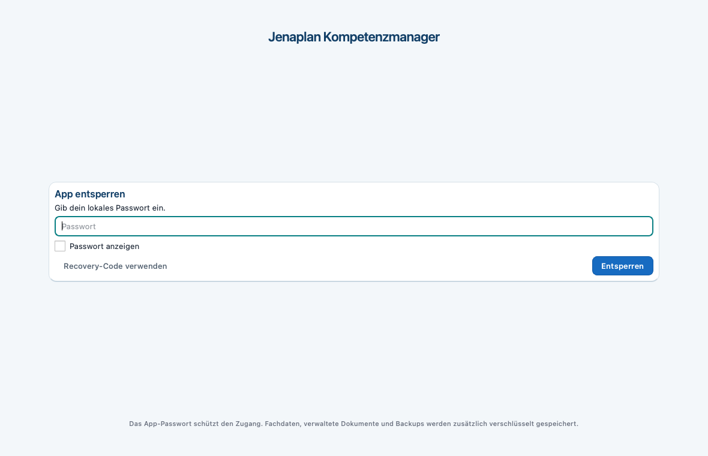
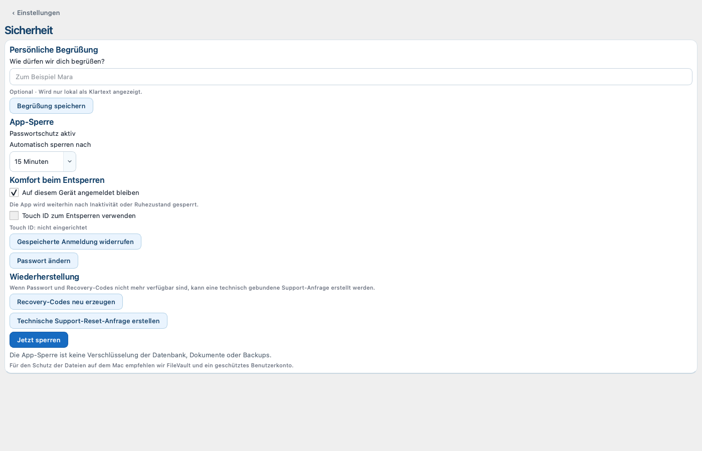
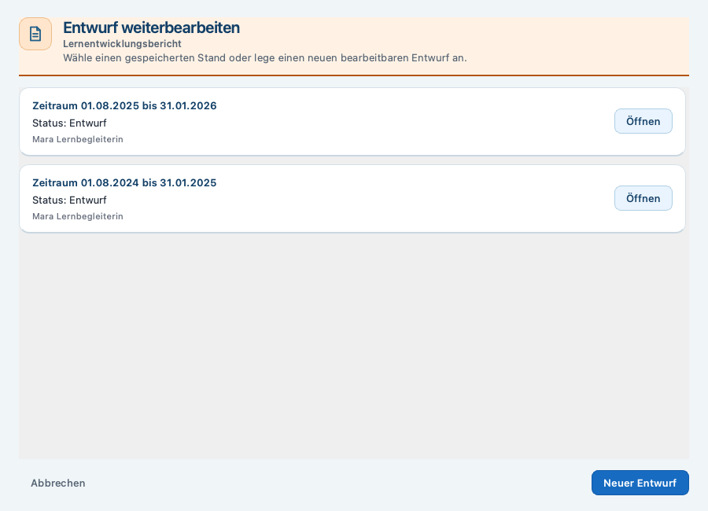
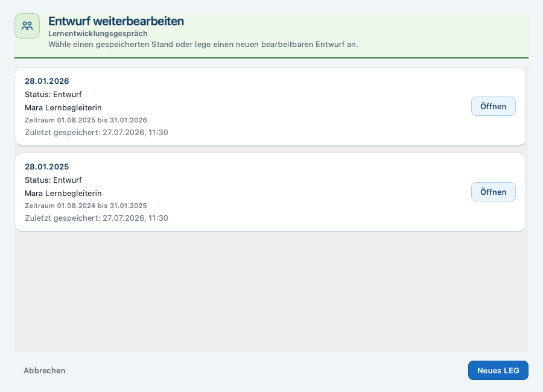
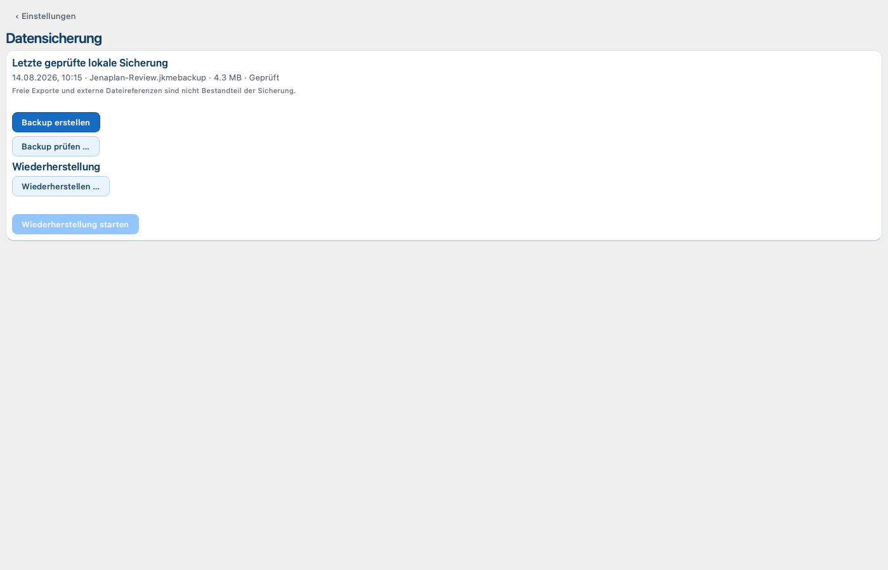
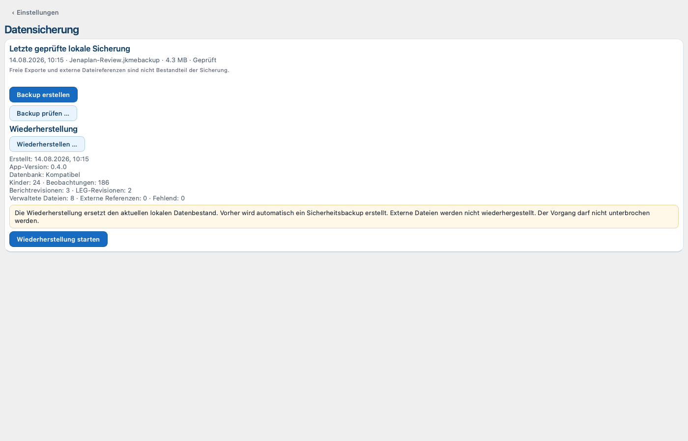
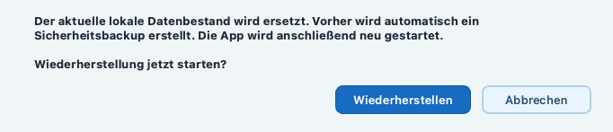

# Jenaplan-Kompetenzmanager - Benutzerhandbuch

## 1. Titel und Versionsstand

- Produktversion: {{PILOT_VERSION}}
- Vorgesehener Releasekandidat: Build {{PILOT_BUILD}}
- Dokumentstand: 27. Juli 2026
- Plattform: macOS auf Apple Silicon (arm64), ab macOS 13
- Status: interner, nicht öffentlicher Pilotstand

Dieses Handbuch beschreibt die lokale Desktop-App. Die Screenshots wurden mit
einer synthetischen lokalen Datenbank und ausschließlich fiktiven Namen erstellt.
Der genaue Produkt-Commit wird erst mit dem späteren Clean-Build als
Artefaktnachweis festgehalten; er ist nicht Teil dieses Dokumentstands.

## 2. Wofür die App da ist

Der Jenaplan-Kompetenzmanager unterstützt Lehrkräfte bei Beobachtungen,
Dokumentationsüberblicken, Lernentwicklungsberichten und
Lernentwicklungsgesprächen. Er ist eine pädagogische Arbeitsgrundlage, keine
automatische Leistungsbewertung und keine Zeugnissoftware.

Die App trennt bewusst vier Arbeitsformen:

- Das Schülerprofil zeigt den aktuellen Arbeitsstand.
- Eine Beobachtung hält eine konkrete Wahrnehmung fest.
- Ein Entwurf bleibt bearbeitbar.
- Eine Revision ist ein eingefrorener, schreibgeschützter Stand eines
  finalisierten Berichts oder abgeschlossenen LEG.

Die Anwendung arbeitet lokal auf dem Mac. Sie nutzt keine Cloud und keine
KI-Funktion.

## 3. Für wen dieses Handbuch ist

### Lehrkräfte

Die Hauptkapitel erklären Beobachtungen, Schülerprofile, Kompetenz-Cockpit,
Berichte, LEG sowie Backup und Wiederherstellung.

### Stammdatenpflege und technische Betreuung

Die Kapitel zu Stammdaten, Stundenplan, Sicherheit und Datensicherung richten
sich an die Personen, die die lokale Arbeitsumgebung pflegen. Es gibt je
Installation ein lokales Lehrkraftkonto; es gibt keine Rollen- oder
Freigabeverwaltung.

## 4. Installation, Start und Version prüfen

### App aus dem DMG installieren

1. Die vereinbarte Datei
   Jenaplan-Kompetenzmanager-{{PILOT_VERSION}}-macOS-arm64.dmg öffnen.
2. Jenaplan-Kompetenzmanager.app in den Ordner Programme ziehen.
3. Das Kopieren abwarten und das DMG im Finder auswerfen.
4. Die App im Ordner Programme regulär öffnen.

Der vorgesehene interne Build wird ad-hoc signiert und nicht notarisiert. macOS kann beim
ersten Start deshalb warnen. Schließen Sie dann den Hinweis, klicken Sie im
Finder bei gedrückter Control-Taste auf die App und wählen Sie Öffnen. Falls
macOS weiterhin blockiert, wählen Sie in Systemeinstellungen > Datenschutz &
Sicherheit nur für diese App Dennoch öffnen.

> [!WARNUNG]
> Deaktivieren Sie Gatekeeper niemals global.

Zum Beenden verwenden Sie Jenaplan-Kompetenzmanager beenden oder schließen Sie
das Hauptfenster. Laufende Sicherungen, Wiederherstellungen und Support-Resets
dürfen dabei nicht unterbrochen werden.

### Version und Build prüfen

Öffnen Sie unten in der Seitenleiste Über die App. Dort stehen Produktversion
und Build. Für diesen Dokumentstand müssen Version {{PILOT_VERSION}} und Build {{PILOT_BUILD}} angezeigt
werden. Ein DMG, eine Prüfsumme oder ein Commit werden erst durch den späteren
Clean-Build belegt; dieses Handbuch behauptet kein bereits erzeugtes
Build-Artefakt.

### Lokale Datenablage

Die fachlichen Daten, verwalteten Dokumente, Ausgaben und Sicherungen liegen im
persönlichen lokalen App-Bereich und getrennt vom App-Bundle. Beim Start werden
vorhandene Fachdaten nicht durch Beispiel- oder Pilotdaten ersetzt. Der genaue
Speicherort muss im Schulalltag nicht manuell verändert werden.

## 5. Anmeldung, Sperre und Unterstützung

### Erstes Passwort anlegen

Beim ersten Start erscheint Lokales Konto einrichten. Legen Sie ein Passwort mit
mindestens 15 Zeichen fest, bestätigen Sie es und wählen Sie Recovery-Codes
erzeugen. Bewahren Sie die angezeigten Recovery-Codes getrennt vom Mac auf. Der
optionale Anzeigename dient nur der lokalen Begrüßung.

### Anmelden und entsperren

Bei jedem normalen Start und nach einer Sperre wird das lokale Passwort
eingegeben. Enter löst die sichtbare Hauptaktion aus. Ein falsches oder
fehlendes Credential entsperrt die App nicht; die Fachoberfläche bleibt
geschlossen. Verwenden Sie bei einem verlorenen Passwort zuerst Recovery-Code
verwenden.

Die App sperrt sich nach der gewählten Inaktivitätszeit oder beim Ruhezustand
des Mac. Unter Einstellungen > Sicherheit können Sie die Sperrzeit wählen und
Jetzt sperren verwenden. Ungespeicherte Eingaben bleiben beim Sperren unter der
Sperransicht erhalten; sie werden nicht automatisch gespeichert.

### Schlüsselbund und Touch ID

Unter Einstellungen > Sicherheit kann nach einer Passwortbestätigung Auf diesem
Gerät angemeldet bleiben aktiviert werden. Dazu speichert die App nicht das
Passwort, sondern ein widerrufbares lokales Gerätecredential im macOS-Schlüsselbund.
Es ist nur eine Komfortfunktion: Die App sperrt weiterhin automatisch und das
Passwort bleibt immer verfügbar.

Touch ID ist optional. Sie kann nur verwendet werden, wenn der Mac Touch ID
unterstützt und eingerichtet hat, die gespeicherte Anmeldung aktiv ist und das
lokale Credential verfügbar ist. Die Oberfläche benennt den Grund sichtbar,
zum Beispiel zuerst gespeicherte Anmeldung aktivieren, nicht eingerichtet,
vorübergehend gesperrt oder auf diesem Mac nicht verfügbar. Nach Abbruch oder
Fehler bleibt sofort der Passwort-Fallback.

Gespeicherte Anmeldung widerrufen, eine Passwortänderung und Recovery entfernen
die Komfortanmeldung. Unter Passwort ändern setzen Sie
nach der Bestätigung des bisherigen Passworts ein neues lokales Passwort.

### Support-Reset

Support-Reset ist im Final-V4-Cipher-Modus kontrolliert blockiert. Seine vor
Authentifizierung erforderliche sichere `.jkmebackup`-Komposition ist noch
nicht freigegeben. Ein Reset-Code, Passwort oder Recovery-Code ersetzt den DMK
nicht und darf keinen Zugriff auf den verschlüsselten Fachbestand vortäuschen.

<!-- pagebreak -->

## 6. Erste Orientierung

Nach der Anmeldung führt die Seitenleiste zu vier Bereichen:

- Heute: Dashboard für Unterricht und Dokumentationsüberblick.
- Schüler: Stammgruppen, Kurse, Kursverbünde und Schülerprofile.
- Stammdaten: Stammgruppen, Kurse und Kursverbünde.
- Einstellungen: Stundenplan, Datensicherung, Sicherheit und weitere lokale
  Einstellungen.

Erste Schritte erklärt die Einrichtung und kann übersprungen oder später in den
Einstellungen erneut geöffnet werden. Sie legt keine Kinder, Beobachtungen oder
Sicherungen automatisch an.

Primäraktionen sind klar beschriftet. Beobachtungen, Berichte und LEG verwenden
zusätzlich ruhige Kontextfarben; die Beschriftung bleibt immer maßgeblich.
Escape und Abbrechen beenden eine Auswahl oder Rückfrage sicher, ohne
versehentlich Daten zu erzeugen oder zu verwerfen.

## 7. Dashboard und Stundenplan

Das Dashboard Heute bündelt die aktuelle oder nächste Stunde, Stundenplan heute,
passende Kinder und Dokumentation im Überblick. Schüler, Dashboard und
Kursverbünde werden gebündelt geladen. Das hält auch größere lokale Bestände im
Unterrichtsalltag übersichtlich, ohne für jeden Eintrag einzeln nachzuladen.

Über + Beobachtung bereiten Sie eine Beobachtung für die hervorgehobene Stunde
vor. Fach und Ziel bleiben vorgefüllt, können vor dem Speichern aber geprüft und
angepasst werden. Ohne Stundenplan erklärt die App den nächsten sinnvollen
Schritt.

### Stundenplan pflegen

1. Einstellungen und dann Stundenplan öffnen.
2. Wochentag wählen und Stunde hinzufügen oder Bearbeiten wählen.
3. Zeit, Fach, Zielart, Ziel und bei Bedarf Raum eintragen.
4. Speichern; die App weist auf ungültige Zeiten und Überschneidungen hin.

Ein deaktivierter Eintrag bleibt sichtbar und kann wieder aktiviert werden.
Gelöschte Stunden lassen sich nicht über die Oberfläche wiederherstellen.

## 8. Beobachtungen und Anhänge

### Beobachtung erfassen

Öffnen Sie Beobachten oder Beobachtung erfassen, prüfen Sie Kind, Fach, Kontext
und Datum und wählen Sie passende Kompetenzen. Jede normale Beobachtung benötigt
mindestens eine bewertete Kompetenz. Ergänzen Sie eine pädagogisch verständliche
Notiz und speichern Sie bewusst.

Eine Schnellbeobachtung erfasst zunächst eine Notiz ohne Kompetenzzuordnung. Sie
kann später bearbeitet und fachlich ergänzt werden.

### Anhänge und sichere Bearbeitung

Unter Dokumente & Medien können Sie eine passende lokale Datei anfügen. Die App
behandelt Beobachtung und Anhänge als kontrollierten Gesamtvorgang. Wenn das
Speichern fehlschlägt, entsteht keine zweite Beobachtung. Bei einer
fehlgeschlagenen Bearbeitung bleiben bereits gültige Altanhänge erhalten.

Warten Sie immer die Rückmeldung zum Speichern ab. Ändern oder schließen Sie
den Dialog nicht, solange ein Vorgang noch läuft. Technische Journal- und
Recoverydetails müssen im Unterricht nicht bedient werden.

### Bestätigungsstände

Im Kompetenz-Cockpit kann ein historischer Bestätigungsstand als
Bestätigungsstand unklar - bitte erneut bestätigen erscheinen, wenn die frühere
Reihenfolge nicht sicher beweisbar ist. Das ist keine negative Bewertung. Eine
erneute fachliche Bestätigung löst den unklaren Stand auf.

## 9. Schülerprofil und Kompetenz-Cockpit

Das Schülerprofil bündelt Überblick, Beobachtungen, Kompetenzen, Bericht und
Dateien. Der Überblick zeigt die neuesten Beobachtungen und offene
Dokumentationsbereiche, aber keine Note oder Rangfolge.

Im Kompetenz-Cockpit führen Fachkarten über Kompetenzbereich und Thema zur
einzelnen Kompetenz. Filter für Fach, Klassenstufe und Dokumentationszustand
helfen bei der Orientierung. Historische Katalogbezüge bleiben lesbar, können
aber nicht unbemerkt neu ausgewählt werden.

Noch nicht dokumentiert bedeutet lediglich, dass kein aktiver Beleg oder
Bestätigungsstand vorliegt. Es sagt nichts darüber aus, was ein Kind kann oder
nicht kann.

## 10. Lernentwicklungsberichte

### Entwurf auswählen oder neu beginnen

Bericht öffnen zeigt bei vorhandenen Entwürfen die Auswahl
Lernentwicklungsbericht auswählen.

- Ohne Entwurf beginnt die Werkstatt mit einem neuen, noch ungespeicherten
  Entwurf.
- Bei genau einem oder mehreren Entwürfen können Sie einen vorhandenen, auch
  älteren Entwurf mit Öffnen wählen.
- Neuer Entwurf beginnt bewusst einen eigenen Entwurf.
- Abbrechen erzeugt keine Daten.

Eine neue technische Entwurfs-ID entsteht erst beim ersten Speichern. Ein neuer
Zeitraum ist kein Revisionswechsel eines alten Berichts, sondern gehört in einen
bewusst neuen Entwurf.

### Berichtswerkstatt

In der Werkstatt verfassen Sie den pädagogischen Gesamtblick und die Fachtexte,
wählen Kompetenzen und Belege und prüfen die Vorschau. Texte werden von der
Lehrkraft geschrieben; es gibt keine automatische Textgenerierung.

Entwurf speichern sichert den aktuellen Stand. Schließen mit ungespeicherten
Änderungen fragt nach Weiter bearbeiten, Änderungen verwerfen oder Entwurf
speichern.

### Finalisieren, Revisionen und PDF

Eine Finalisierung erzeugt eine unveränderliche Revision erst nach Prüfung und
ausdrücklicher Bestätigung. Der bearbeitbare Entwurf bleibt bestehen. Spätere
Änderungen und eine erneute Finalisierung erzeugen eine neue Revision; ältere
Revisionen bleiben als Ersetzt erhalten. Eine geöffnete Revision ist
schreibgeschützt.

Finales PDF erstellen erzeugt eine verwaltete Ausgabe aus der aktuellen
Revision. Die Finalisierung selbst erzeugt kein PDF automatisch. Ein
Entwurfs-PDF ist dagegen eine frei gewählte Arbeitsausgabe und keine Revision.

## 11. Lernentwicklungsgespräche (LEG)

Lernentwicklungsgespräch öffnen zeigt bei gespeicherten Entwürfen die Auswahl.
Auch bei genau einem Entwurf können Sie ihn öffnen oder mit Neues LEG bewusst
ein eigenes Gesprächsaggregat beginnen. Ein neues LEG wird nicht als Revision
eines früheren Gesprächs fortgeführt.

Im LEG-Arbeitsbereich führen sechs Phasen durch Vorbereitung, Gespräch,
Kompetenzen, Belege sowie gemeinsame Vereinbarungen. Interne Vorbereitung und
gemeinsam festgehaltene Ergebnisse bleiben getrennt.

Entwurf speichern erhält den Arbeitsstand. Gespräch abschließen erzeugt nach
Prüfung und Bestätigung eine schreibgeschützte Abschlussrevision. Eine spätere
Änderung im Entwurf erzeugt erst beim erneuten Abschluss eine neue Revision.
Nur die aktuelle Abschlussrevision kann ein finales LEG-PDF erzeugen.

## 12. Backup und Wiederherstellung

### Backup erstellen und prüfen

Öffnen Sie Einstellungen > Datensicherung und wählen Sie Backup erstellen.
Wählen Sie einen schulisch freigegebenen lokalen Zielordner. Die App zeigt den
Status der zuletzt geprüften Sicherung. Mit Backup prüfen ... kann eine
Sicherung vor einer Wiederherstellung oder einem Update nochmals geprüft werden.

> [!KONTROLLE]
> Der aktuelle Produktpfad verwendet ausschließlich das verschlüsselte,
> authentisierte und installationsgebundene `.jkmebackup`. Bewahren Sie
> zusätzlich eine externe, schulisch geregelte Sicherung vor Updates auf.
> Gerätewechsel und DMK-Verlust sind damit nicht gelöst.

### Restore-Vorschau und ausdrückliche Bestätigung

1. Wiederherstellen ... wählen und eine geprüfte Sicherung auswählen.
2. Die Restore-Vorschau lesen.
3. Nur bei passendem Bestand Wiederherstellung starten wählen.
4. Die ausdrückliche Bestätigung Wiederherstellen geben.

Die Wiederherstellung ersetzt den aktiven fachlichen Bestand erst nach
erfolgreicher Prüfung. Zuvor erstellt die App ein Sicherheitsbackup. Dann
übergibt sie die Arbeit an einen separaten Restore-Worker, beendet sich
vollständig und startet kontrolliert neu. Es bleibt kein kleines Restfenster der
alten App offen.

> [!FEHLERBEHEBUNG]
> Nach dem Neustart melden Sie sich erneut an und prüfen Schüler, Beobachtungen,
> Dokumente sowie Berichts- und LEG-Daten. Kann der Worker nicht sicher gestartet
> werden, zeigt die App eine Fehlermeldung; der bisherige aktive Bestand bleibt
> unverändert. Brechen Sie niemals durch Ausschalten oder gewaltsames Beenden ab,
> wenn ein Restore läuft.

Der same-installation Restore übernimmt keine Zugangsdaten, Recovery-Codes,
gespeicherte Anmeldung oder Touch-ID-Einstellung. Diese Sicherheitsdaten bleiben
getrennt; auf einem anderen Gerät ist der Container nicht freigegeben.

## 13. Stammdaten

Unter Stammdaten pflegen Sie Stammgruppen, Kurse und Kursverbünde. Ein Kind
braucht eine Stammgruppe und einen Kurs. Kursverbünde bündeln mehrere
Stammgruppen und Kurse für Unterrichtsziele und Dashboard-Kontexte.

Pflegen Sie Stammdaten bewusst vor dem Anlegen vieler Schüler. Historische
fachliche Bezüge bleiben in vorhandenen Beobachtungen und Revisionen lesbar,
auch wenn ein aktueller Katalogbezug später nicht mehr auswählbar ist.

## 14. Typische Arbeitsabläufe

### Eine leere Anwendung einrichten

1. Lokales Passwort anlegen und Recovery-Codes getrennt sichern.
2. Unter Stammdaten mindestens eine Stammgruppe und einen Kurs anlegen.
3. Optional Kursverbünde anlegen.
4. Schüler anlegen.
5. Dokumentationsfächer und Stundenplan prüfen.
6. Eine erste Beobachtung erfassen.
7. Ein geprüftes lokales Backup erstellen.

### Während einer Stunde dokumentieren

1. Heute öffnen und die aktuelle oder nächste Stunde prüfen.
2. + Beobachtung und beim passenden Kind Beobachten wählen.
3. Vorbelegung, Kontext, Kompetenz und Notiz prüfen.
4. Bewusst speichern und Rückmeldung abwarten.

### Bericht mit neuem Zeitraum beginnen

1. Schülerprofil und Bericht öffnen wählen.
2. In der Auswahl Neuer Entwurf wählen.
3. Den neuen Zeitraum und die verantwortliche Lehrkraft eintragen.
4. Texte, Fächer, Kompetenzen und Belege bearbeiten.
5. Erst bei Entwurf speichern entsteht der neue Entwurf.

### Wiederherstellung sicher abschließen

1. Externes Backup und eigene Datenlage prüfen.
2. Restore-Vorschau genau lesen.
3. Wiederherstellung bewusst bestätigen.
4. Kontrolliertes App-Ende und Neustart abwarten.
5. Erneut anmelden und fachliche Daten prüfen.

## 15. Sicherheit, Datenschutz und lokale Datenhaltung

> [!SICHERHEIT]
> Die App überträgt keine Fachdaten in eine Cloud und nutzt keine KI. Aktuell aktiv
> sind lokales Passwort, Keychain-gestützte Komfortanmeldung, optionales Touch ID,
> automatische Sperre, Passwort-Fallback sowie verschlüsseltes lokales
> `.jkmebackup` und same-installation Restore. Support-Reset bleibt blockiert.

> [!HINWEIS]
> App-Sperre und Verschlüsselung sind getrennte Schutzschichten. Der committed
> Produktpfad verwendet für einen frischen Final-V4-Bestand SQLCipher 4.17,
> verschlüsselte Managed Documents und `.jkmebackup`. Bestehende Klartext-, V3-
> und Alt-Testdaten werden nicht migriert. Build-, Keychain- und Realweltabnahme
> bleiben gesonderte Gates.

Finale verwaltete Bericht-/LEG-Artefakte liegen als verschlüsselte `.jkmedoc`
im Managed Document Store. Bewusst frei exportierte PDFs liegen außerhalb der
App im Klartext. Behandeln Sie sie wie andere vertrauliche Schulunterlagen. Das
ausführliche Dokument docs/SICHERHEIT_UND_VERSCHLUESSELUNG.md erläutert
Schutzstand, Grenzen und Verantwortlichkeiten der Schule.

Für Lehrkräfte gilt im Alltag:

- Nur freigegebene Macs und geschützte Benutzerkonten verwenden.
- Gerätesperre und FileVault nach Schulvorgabe aktiv halten.
- Keine echten Schülerdaten in Testdaten, Screenshots oder Fehlermeldungen
  weitergeben.
- Exporte und PDFs nur über sichere schulische Wege weitergeben.
- Regelmäßig geprüfte, externe Sicherungen vorhalten.
- Verlust eines Geräts oder einen Sicherheitsverdacht sofort melden.

## 16. Bewusste Grenzen des Standes {{PILOT_VERSION}} / Build {{PILOT_BUILD}}

Nicht produktiv aktiviert oder freigegeben sind:

- automatische SQLCipher-Migration bestehender Fachdaten;
- Gerätewechsel- und DMK-Recovery;
- Support-Reset im Cipher-Modus;
- automatische Produktmigration und physisches Löschen alter Daten;
- Windows oder ein DPAPI-Pfad;
- Developer-ID-Signierung und Apple-Notarisierung;
- ein öffentlicher Stable-Release oder Stable-Appcast.

Es gibt weiterhin keine Cloud-Synchronisation, Mehrgeräte-Zusammenarbeit,
automatische Textgenerierung oder automatische Benotung.

## 17. Glossar

**Bestätigter Stand:** Bewusst bestätigter Kompetenzstand, getrennt von einem
Vorschlag aus Beobachtungen.

**Entwurf:** Bearbeitbarer Arbeitsstand eines Berichts oder LEG.

**Finales PDF:** Manuell erzeugte Ausgabe aus der aktuellen unveränderlichen
Revision.

**Kursverbund:** Zusammenfassung mehrerer Stammgruppen und Kurse für
Unterrichtsziele und Schülerkontexte.

**LEG:** Lernentwicklungsgespräch mit Vorbereitung, Gespräch und
Abschlussrevision.

**Revision:** Unveränderlicher gespeicherter Stand nach Finalisierung oder
Gesprächsabschluss.

**Schnellbeobachtung:** Kurze Beobachtung mit Notiz und zunächst ohne
Kompetenzzuordnung.
