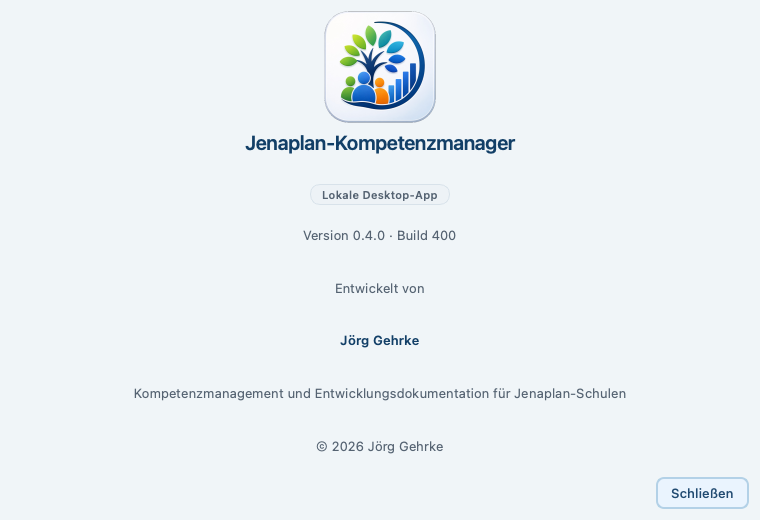
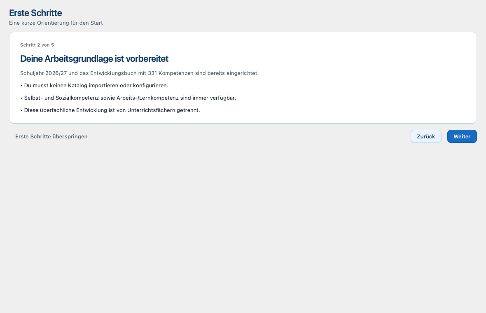
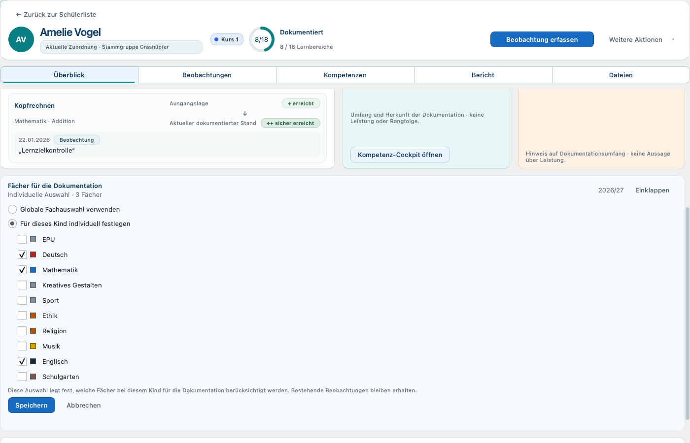

# Jenaplan-Kompetenzmanager - Benutzerhandbuch

## 1. Titel und Versionsstand

- Produktversion: {{PILOT_VERSION}}
- Vorbereiteter Pilotbuild: {{PILOT_BUILD}}
- Dokumentstand: 14. August 2026
- Plattform: macOS auf Apple Silicon (arm64), ab macOS 13
- Status: vorbereiteter Final-V4-Pilotstand; noch kein finales App-Bundle oder
  Releaseartefakt

Dieses Handbuch beschreibt die lokale Qt-Desktop-App. Alle eingebundenen
Screenshots werden aus einem datenschutzneutralen synthetischen Bestand mit der
aktuellen Qt-Oberfläche erzeugt. Die Ausgabe bleibt ein Reviewdokument; der
genaue Produkt-Commit wird erst mit dem späteren sauberen Build als
Artefaktnachweis festgehalten.

## 2. Wofür die App da ist

Der Jenaplan-Kompetenzmanager unterstützt Lehrkräfte bei Beobachtungen,
Dokumentationsüberblicken, Lernentwicklungsberichten und
Lernentwicklungsgesprächen. Er ist eine pädagogische Arbeitsgrundlage, keine
automatische Leistungsbewertung und keine Zeugnissoftware.

Die App trennt bewusst vier Arbeitsformen:

- Das Schülerprofil zeigt den aktuellen Arbeitsstand.
- Eine Beobachtung hält eine konkrete Wahrnehmung fest.
- Ein Entwurf bleibt bearbeitbar.
- Eine Revision ist ein eingefrorener, schreibgeschützter Stand eines
  finalisierten Berichts oder abgeschlossenen LEG.

Die Anwendung arbeitet lokal auf dem Mac. Sie nutzt keine Cloud und keine
KI-Funktion.

## 3. Für wen dieses Handbuch ist

### Lehrkräfte

Die Hauptkapitel erklären Beobachtungen, Schülerprofile, Kompetenz-Cockpit,
Berichte, LEG sowie Backup und Wiederherstellung.

### Stammdatenpflege und technische Betreuung

Die Kapitel zu Stammdaten, Stundenplan, Sicherheit und Datensicherung richten
sich an die Personen, die die lokale Arbeitsumgebung pflegen. Es gibt je
Installation ein lokales Lehrkraftkonto; es gibt keine Rollen- oder
Freigabeverwaltung.

## 4. Installation, Start und Version prüfen

### App aus dem DMG installieren

1. Die vereinbarte Datei
   Jenaplan-Kompetenzmanager-{{PILOT_VERSION}}-macOS-arm64.dmg öffnen.
2. Jenaplan-Kompetenzmanager.app in den Ordner Programme ziehen.
3. Das Kopieren abwarten und das DMG im Finder auswerfen.
4. Die App im Ordner Programme regulär öffnen.

Der aktuelle interne Pilotvertrag ist ad-hoc signiert und nicht notarisiert.
Ein internes Artefakt kann beim ersten Start deshalb von macOS blockiert
werden. Schließen Sie dann den Hinweis, klicken Sie im Finder bei gedrückter
Control-Taste auf die App und wählen Sie Öffnen. Falls
macOS weiterhin blockiert, wählen Sie in Systemeinstellungen > Datenschutz &
Sicherheit nur für diese App Dennoch öffnen.

> [!WARNUNG]
> Deaktivieren Sie Gatekeeper niemals global.

Zum Beenden verwenden Sie Jenaplan-Kompetenzmanager beenden oder schließen Sie
das Hauptfenster. Laufende Sicherungen, Wiederherstellungen und Support-Resets
dürfen dabei nicht unterbrochen werden.

### Version und Build prüfen

Öffnen Sie unten in der Seitenleiste Über die App. Dort stehen Produktversion
und Build. Ein später zur Pilotprüfung übergebenes Artefakt muss Version
{{PILOT_VERSION}} und Build {{PILOT_BUILD}} anzeigen. Ein DMG, eine Prüfsumme
oder ein Commit werden erst durch den späteren sauberen Build belegt; dieses
Handbuch behauptet kein bereits erzeugtes Build-Artefakt.

### Lokale Datenablage

Die fachlichen Daten und verwalteten Dokumente werden verschlüsselt im
persönlichen lokalen App-Bereich und getrennt vom App-Bundle gespeichert. Beim
Start werden vorhandene Fachdaten nicht durch Beispiel- oder Pilotdaten
ersetzt. Der genaue Speicherort muss im Schulalltag nicht manuell verändert
werden.

## 5. Anmeldung, Sperre und Unterstützung

### Erstes Passwort anlegen

Beim ersten Start erscheint Lokales Konto einrichten. Legen Sie ein Passwort mit
mindestens 15 Zeichen fest, bestätigen Sie es und wählen Sie Recovery-Codes
erzeugen. Bewahren Sie die angezeigten Recovery- und Sicherheitsinformationen
getrennt vom Mac auf. Der optionale Anzeigename dient nur der lokalen Begrüßung.

### Anmelden und entsperren

Bei jedem normalen Start und nach einer Sperre wird das lokale Passwort
eingegeben. Enter löst die sichtbare Hauptaktion aus. Ein falsches oder
fehlendes Credential entsperrt die App nicht; die Fachoberfläche bleibt
geschlossen. Verwenden Sie bei einem verlorenen Passwort zuerst Recovery-Code
verwenden.

Die App sperrt sich nach der gewählten Inaktivitätszeit oder beim Ruhezustand
des Mac. Unter Einstellungen > Sicherheit können Sie die Sperrzeit wählen und
Jetzt sperren verwenden. Ungespeicherte Eingaben bleiben beim Sperren unter der
Sperransicht erhalten; sie werden nicht automatisch gespeichert.

### Schlüsselbund und Touch ID

Unter Einstellungen > Sicherheit kann nach einer Passwortbestätigung Auf diesem
Gerät angemeldet bleiben aktiviert werden. Dazu speichert die App nicht das
Passwort, sondern ein widerrufbares lokales Gerätecredential im macOS-Schlüsselbund.
Es ist nur eine Komfortfunktion: Die App sperrt weiterhin automatisch und das
Passwort bleibt immer verfügbar.

Touch ID ist optional. Sie kann nur verwendet werden, wenn der Mac Touch ID
unterstützt und eingerichtet hat, die gespeicherte Anmeldung aktiv ist und das
lokale Credential verfügbar ist. Die Oberfläche benennt den Grund sichtbar,
zum Beispiel zuerst gespeicherte Anmeldung aktivieren, nicht eingerichtet,
vorübergehend gesperrt oder auf diesem Mac nicht verfügbar. Nach Abbruch oder
Fehler bleibt sofort der Passwort-Fallback.

Gespeicherte Anmeldung widerrufen, eine Passwortänderung und Recovery entfernen
die Komfortanmeldung. Unter Passwort ändern setzen Sie
nach der Bestätigung des bisherigen Passworts ein neues lokales Passwort.

### Support-Reset

Support-Reset ist ausschließlich auf der ursprünglichen, technisch intakten
Installation möglich. Vor dem Zurücksetzen prüft die App den vorhandenen
geschützten Datenbestand vollständig und erzeugt und verifiziert ein neues
verschlüsseltes Safety-Backup. Erst danach werden Passwort, Recovery-Codes und
gespeicherte Anmeldungen zurückgesetzt; beim nächsten Start müssen ein neues
Passwort und neue Recovery-Codes eingerichtet werden. Der Support erhält dabei
keinen Zugriff auf Fachdaten. Ein Reset-Code ersetzt den geschützten
Installationsschlüssel nicht: Fehlt dieser oder ist der lokale Bestand nicht
vollständig prüfbar, findet kein Reset statt. Gerätewechsel werden dadurch
nicht ermöglicht.

<!-- pagebreak -->

## 6. Erste Orientierung und Pilotstart

Nach der Anmeldung führt die Seitenleiste zu vier Bereichen:

- Heute: Dashboard für Unterricht und Dokumentationsüberblick.
- Schüler: Stammgruppen, Kurse, Kursverbünde und Schülerprofile.
- Stammdaten: Stammgruppen, Kurse und Kursverbünde.
- Einstellungen: Stundenplan, Datensicherung, Sicherheit und weitere lokale
  Einstellungen.

Erste Schritte erklärt in fünf kurzen, nicht blockierenden Schritten den
sicheren Start und kann übersprungen oder später in den Einstellungen erneut
geöffnet werden. Die Ansicht legt keine Kinder, Beobachtungen oder Sicherungen
automatisch an.

Für den frischen Pilotbestand gehen Sie in dieser Reihenfolge vor:

1. Passwort anlegen und Recovery-Codes getrennt vom Mac sichern.
2. Die vorbereitete Arbeitsgrundlage nutzen: Schuljahr `2026/27`, offizielles
   Entwicklungsbuch und 331 Kompetenzen sind bereits vorhanden.
3. Stammgruppen und Kurse anlegen; Kursverbünde und Stundenplan sind optional.
4. Schüler selbst anlegen und im Schülerprofil unter `Überblick > Fächer für
   die Dokumentation` ihre relevanten Unterrichtsfächer festlegen.
5. Eine erste Beobachtung erfassen und ein verschlüsseltes `.jkmebackup`
   erstellen.

Automatisch angelegt werden keine Schüler, Stammgruppen, Kurse, Kursverbünde,
Beobachtungen, Bestätigungen, Berichtsentwürfe, LEG-Entwürfe, Testdokumente,
Beispielbestände oder Testbackups.

Primäraktionen sind klar beschriftet. Beobachtungen, Berichte und LEG verwenden
zusätzlich ruhige Kontextfarben; die Beschriftung bleibt immer maßgeblich.
Escape und Abbrechen beenden eine Auswahl oder Rückfrage sicher, ohne
versehentlich Daten zu erzeugen oder zu verwerfen.

## 7. Dashboard und Stundenplan

Das Dashboard Heute bündelt die aktuelle oder nächste Stunde, Stundenplan heute,
passende Kinder und Dokumentation im Überblick. Schüler, Dashboard und
Kursverbünde werden gebündelt geladen. Das hält auch größere lokale Bestände im
Unterrichtsalltag übersichtlich, ohne für jeden Eintrag einzeln nachzuladen.

Über + Beobachtung bereiten Sie eine Beobachtung für die hervorgehobene Stunde
vor. Fach und Ziel bleiben vorgefüllt, können vor dem Speichern aber geprüft und
angepasst werden. Ohne Stundenplan erklärt die App den nächsten sinnvollen
Schritt.

### Stundenplan pflegen

1. Einstellungen und dann Stundenplan öffnen.
2. Wochentag wählen und Stunde hinzufügen oder Bearbeiten wählen.
3. Zeit, Fach, Zielart, Ziel und bei Bedarf Raum eintragen.
4. Speichern; die App weist auf ungültige Zeiten und Überschneidungen hin.

Ein deaktivierter Eintrag bleibt sichtbar und kann wieder aktiviert werden.
Gelöschte Stunden lassen sich nicht über die Oberfläche wiederherstellen.

## 8. Beobachtungen und Anhänge

### Beobachtung erfassen

Öffnen Sie Beobachten oder Beobachtung erfassen, prüfen Sie Kind, Fach, Kontext
und Datum und wählen Sie passende Kompetenzen. Jede normale Beobachtung benötigt
mindestens eine bewertete Kompetenz. Ergänzen Sie eine pädagogisch verständliche
Notiz und speichern Sie bewusst.

Das Feld `Fach · Katalogfilter` gliedert die Auswahl in drei sichtbare Gruppen:

- `Überfachliche Entwicklung`: Selbst- und Sozialkompetenz sowie
  Arbeits-/Lernkompetenz; beide bleiben unabhängig vom Fachprofil immer verfügbar.
- `Fächer`: die für dieses Kind aktuell wirksamen Unterrichtsfächer.
- `Weitere Fächer`: andere aktive Unterrichtsfächer, die weiterhin bewusst
  erreichbar sind.

Ein Fachwechsel filtert nur den Katalog. Er ändert weder die im Schülerprofil
gespeicherte Fachauswahl noch bereits ausgewählte Kompetenzen und Bewertungen.
Bei einer bewusst leeren individuellen Fachauswahl entsteht keine neue
automatische Auswahl: `Fächer` bleibt leer, die überfachliche Entwicklung
bleibt verfügbar und alle aktiven Unterrichtsfächer sind unter `Weitere
Fächer` erreichbar.

Eine Schnellbeobachtung erfasst zunächst eine Notiz ohne Kompetenzzuordnung. Sie
kann später bearbeitet und fachlich ergänzt werden.

### Anhänge und sichere Bearbeitung

Unter Dokumente & Medien können Sie eine passende lokale Datei anfügen. Die App
behandelt Beobachtung und Anhänge als kontrollierten Gesamtvorgang. Wenn das
Speichern fehlschlägt, entsteht keine zweite Beobachtung. Bei einer
fehlgeschlagenen Bearbeitung bleiben bereits gültige Altanhänge erhalten.

Warten Sie immer die Rückmeldung zum Speichern ab. Ändern oder schließen Sie
den Dialog nicht, solange ein Vorgang noch läuft. Technische Journal- und
Recoverydetails müssen im Unterricht nicht bedient werden.

### Bestätigungsstände

Im Kompetenz-Cockpit kann ein historischer Bestätigungsstand als
Bestätigungsstand unklar - bitte erneut bestätigen erscheinen, wenn die frühere
Reihenfolge nicht sicher beweisbar ist. Das ist keine negative Bewertung. Eine
erneute fachliche Bestätigung löst den unklaren Stand auf.

## 9. Schülerprofil und Kompetenz-Cockpit

Das Schülerprofil bündelt Überblick, Beobachtungen, Kompetenzen, Bericht und
Dateien. Der Überblick zeigt die neuesten Beobachtungen und offene
Dokumentationsbereiche, aber keine Note oder Rangfolge.

Im Kompetenz-Cockpit führen Fachkarten über Kompetenzbereich und Thema zur
einzelnen Kompetenz. Filter für Fach und Dokumentationszustand helfen bei der
Orientierung. Historische Katalogbezüge bleiben lesbar, können aber nicht
unbemerkt neu ausgewählt werden.

Noch nicht dokumentiert bedeutet lediglich, dass kein aktiver Beleg oder
Bestätigungsstand vorliegt. Es sagt nichts darüber aus, was ein Kind kann oder
nicht kann.

### Unterrichtsfächer für ein Kind festlegen

1. `Schüler` öffnen und das gewünschte Kind über `Profil öffnen` auswählen.
2. Im Profil den Bereich `Überblick` öffnen.
3. Die Karte `Fächer für die Dokumentation` mit `Aufklappen` öffnen.
4. `Für dieses Kind individuell festlegen` wählen.
5. Unterrichtsfächer markieren und `Speichern` wählen.

Die Alternative `Globale Fachauswahl verwenden` übernimmt die vorhandene
Voreinstellung. Sie ist ein Defaultmodus, nicht die alleinige Produktlogik.
Die individuelle Auswahl enthält ausschließlich EPU, Deutsch, Mathematik,
Kreatives Gestalten, Sport, Ethik, Religion, Musik, Englisch und Schulgarten.

Die Fachauswahl beschreibt, welche Unterrichtsfächer für dieses Kind im
normalen Dokumentationsworkflow primär relevant sind. Sie löscht keine Fächer,
Kompetenzen, Beobachtungen oder historischen Nachweise und ist keine harte
fachliche Berechtigungsgrenze. Auch eine bewusst leere individuelle Auswahl
kann gespeichert werden und wird nicht automatisch mit der globalen Auswahl
oder aus Beobachtungen neu befüllt.

### Überfachliche Entwicklung und Unterrichtsfächer

Selbst- und Sozialkompetenz sowie Arbeits-/Lernkompetenz bilden die überfachliche
Entwicklung. Sie sind immer verfügbar, aber keine Unterrichtsfächer. Deshalb
erscheinen sie nicht im Stundenplan und müssen beim Kind nicht ausgewählt
werden. Die vorhandene allgemeine Voreinstellung `Fächer für die Dokumentation`
kann sie als Dokumentationsbereiche aufführen; dadurch werden sie nicht zu
Unterrichtsfächern. Beobachtung, Kompetenz-Cockpit, Bericht und LEG zeigen sie
in ihren tatsächlichen Dokumentationskontexten.

Die zehn Unterrichtsfächer sind EPU, Deutsch, Mathematik, Kreatives Gestalten,
Sport, Ethik, Religion, Musik, Englisch und Schulgarten. Für das aktuelle
Schuljahr werden die relevanten Unterrichtsfächer direkt beim jeweiligen Kind
gepflegt. Überfachliche Entwicklung bleibt unabhängig von dieser Auswahl
vorhanden und erscheint nicht als Checkbox der individuellen
Unterrichtsfachauswahl. Historische Schuljahre sind nicht für normale
nachträgliche Änderungen des Fachprofils gedacht.

Kleine Farbmarker helfen bei der Orientierung, aber der Fachname bleibt immer
sichtbar. Kurs-, Rating- und Statusfarben haben getrennte Bedeutungen. Für EPU
und Kreatives Gestalten ist noch keine eigene Fachfarbe festgelegt.

### Entwicklungsübersicht

Beim Öffnen erscheinen unmittelbar Timeline, Fachkarten und
Dokumentationsumfang für das aktuelle Schuljahr. Die individuellen
Dokumentationsfächer des Kindes werden berücksichtigt. Dafür muss kein
Berichtsentwurf vorhanden oder ausgewählt sein.

Das Kompetenz-Cockpit zeigt die beiden überfachlichen Bereiche immer und sonst
die für dieses Kind wirksamen Unterrichtsfächer. Vorhandene dokumentierte
Evidenz aus einem aktuell nicht primären Fach wird dadurch nicht gelöscht und
bleibt in den dafür vorgesehenen historischen beziehungsweise ergänzenden
Kontexten lesbar.

Die Übersicht zeigt dokumentierte Ereignisse und Mengen neutral. Sie berechnet
keine Stärke, Schwäche, Punktzahl, Entwicklungstendenz oder pädagogische
Priorität. Die Lehrkraft deutet die Beobachtungen fachlich selbst.

## 10. Lernentwicklungsberichte

Ein Bericht ist ein eigenes Arbeitsprodukt. Seine Beobachtungs- und Belegbasis
verwendet den Zeitraum des konkreten Berichtsentwurfs, nicht automatisch das
gesamte aktuelle Schuljahr der Entwicklungsübersicht.

### Entwurf auswählen oder neu beginnen

Bericht öffnen zeigt bei vorhandenen Entwürfen die Auswahl
Lernentwicklungsbericht auswählen.

- Ohne Entwurf beginnt die Werkstatt mit einem neuen, noch ungespeicherten
  Entwurf.
- Bei vorhandenen Entwürfen können Sie einen konkreten, auch älteren Entwurf
  mit Öffnen wählen. Bei mehreren Entwürfen trifft die App keine unbemerkte
  automatische Auswahl.
- Neuer Entwurf beginnt bewusst einen eigenen Entwurf.
- Abbrechen erzeugt keine Daten.

Eine neue technische Entwurfs-ID entsteht erst beim ersten Speichern. Ein neuer
Zeitraum ist kein Revisionswechsel eines alten Berichts, sondern gehört in einen
bewusst neuen Entwurf.

### Berichtswerkstatt

Die Werkstatt führt durch drei frei wechselbare Aufgaben:

1. `Auswählen`: Fächer, Kompetenzen, Beobachtungsbelege und optionale Diagramme
   bewusst auswählen.
2. `Schreiben`: pädagogischen Gesamtblick und Fachtexte verfassen.
3. `Prüfen & finalisieren`: die vollständige Entwurfsvorschau lesen und den
   gespeicherten Stand bewusst finalisieren.

Dies ist kein starrer Assistent. Sie können jederzeit zwischen Auswählen und
Schreiben wechseln. Texte werden von der Lehrkraft geschrieben; es gibt keine
automatische Textgenerierung und keinen automatisch gesetzten Fertigstatus.
Die bewusst ausgewählten Belege bleiben beim Schreiben zur Orientierung
read-only sichtbar; Änderungen an der Auswahl erfolgen unter `Auswählen`.
Frühere unveränderliche Revisionen sind im dritten Schritt sekundär über
`Frühere Fassungen` erreichbar.

Die Fachauswahl des Kindes bestimmt, welche Unterrichtsfächer in der
Berichtsvorbereitung zuerst unter `Fächer des Kindes` angeboten werden. Andere
aktive Unterrichtsfächer bleiben unter `Weitere Fächer` bewusst erreichbar;
erst die Auswahl im Bericht nimmt ein Fach in den Entwurf auf.

Die überfachliche Entwicklung bleibt im Bericht-Überblick sichtbar. Sie ist
keine Unterrichtsfach-Checkbox der Vorbereitung und wird nicht durch die
individuelle Unterrichtsfachauswahl des Kindes ein- oder ausgeschaltet.

Entwurf speichern sichert den aktuellen Stand. Schließen mit ungespeicherten
Änderungen fragt nach Weiter bearbeiten, Änderungen verwerfen oder Entwurf
speichern.

### Finalisieren, Revisionen und PDF

Eine Finalisierung erzeugt eine unveränderliche Revision erst nach Prüfung und
ausdrücklicher Bestätigung. Der bearbeitbare Entwurf bleibt bestehen. Spätere
Änderungen und eine erneute Finalisierung erzeugen eine neue Revision; ältere
Revisionen bleiben als Ersetzt erhalten. Eine geöffnete Revision ist
schreibgeschützt.

Finales PDF erstellen erzeugt aus der aktuellen Revision ein verschlüsselt
verwaltetes Artefakt. Die Finalisierung selbst erzeugt kein PDF automatisch.
`Finales PDF anzeigen` öffnet das Artefakt read-only im sicheren In-App-Viewer.
Der Viewer zeigt mehrere Seiten, unterstützt Scrollen und Zoom und kann
geschlossen und erneut geöffnet werden. Export, Drucken und Teilen sind nicht
Teil dieses Produktvertrags.

## 11. Lernentwicklungsgespräche (LEG)

Lernentwicklungsgespräch öffnen zeigt bei gespeicherten Entwürfen die Auswahl.
Auch bei genau einem Entwurf können Sie ihn öffnen oder mit Neues LEG bewusst
ein eigenes Gesprächsaggregat beginnen. Ein neues LEG wird nicht als Revision
eines früheren Gesprächs fortgeführt.

Der LEG-Arbeitsbereich ordnet sechs fachliche Anker in drei verständliche
Arbeitskontexte:

- `Vorbereitung`
- `Im Gespräch`
- `Vereinbarungen & Abschluss`

Die sechs Anker sind Gesprächsziel, Was gelingt dem Kind?, Welche Entwicklung
sehen wir?, Woran möchten wir gemeinsam arbeiten?, Welche Beispiele stützen
unsere Einschätzung? sowie Welche Unterstützung und Vereinbarungen treffen wir?
Kompetenzen und Belege werden primär in der Vorbereitung ausgewählt und bleiben
im Gespräch bei Bedarf read-only sichtbar. Der kanonische Kompetenzstand ist
read-only; das LEG führt keine eigene Bewertung ein.

Das LEG verwendet den kanonischen Kompetenzstand des Kindes und wird nicht auf
die individuell ausgewählten Unterrichtsfächer gefiltert oder danach
umsortiert. Das Fachprofil entfernt keine vorhandenen LEG-Inhalte,
Kompetenzreferenzen oder Belege. Die überfachliche Entwicklung bleibt
unabhängig von der Unterrichtsfachauswahl verfügbar.

Entwurf speichern erhält den Arbeitsstand. Gespräch abschließen erzeugt nach
Prüfung und Bestätigung eine schreibgeschützte Abschlussrevision. Eine spätere
Änderung im Entwurf erzeugt erst beim erneuten Abschluss eine neue Revision.
Nur die aktuelle Abschlussrevision kann ein finales LEG-PDF erzeugen. Das
Artefakt wird verschlüsselt verwaltet und über denselben sicheren read-only
In-App-Viewer wie ein finaler Bericht geöffnet.

## 12. Backup und Wiederherstellung

### Backup erstellen und prüfen

Öffnen Sie Einstellungen > Datensicherung und wählen Sie Backup erstellen.
Wählen Sie einen schulisch freigegebenen lokalen Zielordner. Die App zeigt den
Status der zuletzt geprüften Sicherung. Mit Backup prüfen ... kann eine
Sicherung vor einer Wiederherstellung oder einem Update nochmals geprüft werden.

> [!KONTROLLE]
> Der aktuelle Produktpfad verwendet ausschließlich das verschlüsselte,
> authentisierte und installationsgebundene `.jkmebackup`. Bewahren Sie
> zusätzlich eine externe, schulisch geregelte Sicherung vor Updates auf.
> Gerätewechsel und Verlust des Installationsschlüssels sind damit nicht gelöst.

Das Backup umfasst die verschlüsselte Fachdatenbank und alle für die
Wiederherstellung nötigen registrierten verwalteten Dokumente und Metadaten.
Es enthält weder das lokale Passwort noch Recovery-Codes, Touch-ID- oder
Geräteanmeldedaten und auch nicht den geschützten Installationsschlüssel.

### Restore-Vorschau und ausdrückliche Bestätigung

1. Wiederherstellen ... wählen und eine geprüfte Sicherung auswählen.
2. Die Restore-Vorschau lesen.
3. Nur bei passendem Bestand Wiederherstellung starten wählen.
4. Die ausdrückliche Bestätigung Wiederherstellen geben.

Die App prüft das Backup vor der Übernahme vollständig in einem getrennten
Vorbereitungsbereich. Die Wiederherstellung ersetzt den aktiven fachlichen
Bestand erst nach dieser Prüfung und Ihrer Bestätigung. Zuvor erstellt die App
ein Sicherheitsbackup. Dann übergibt sie die Arbeit an einen separaten
Restore-Worker, beendet sich vollständig und startet kontrolliert neu. Bei
einem Fehler wird der Austausch abgebrochen oder auf den sicheren Ausgangsstand
zurückgesetzt. Es bleibt kein kleines Restfenster der alten App offen.

> [!FEHLERBEHEBUNG]
> Nach dem Neustart melden Sie sich erneut an und prüfen Schüler, Beobachtungen,
> Dokumente sowie Berichts- und LEG-Daten. Kann der Worker nicht sicher gestartet
> werden, zeigt die App eine Fehlermeldung; der bisherige aktive Bestand bleibt
> unverändert. Brechen Sie niemals durch Ausschalten oder gewaltsames Beenden ab,
> wenn ein Restore läuft.

Der installationsgebundene Restore übernimmt keine Zugangsdaten,
Recovery-Codes, gespeicherte Anmeldung oder Touch-ID-Einstellung. Diese
Sicherheitsdaten bleiben getrennt. Die Wiederherstellung benötigt den
passenden bestehenden Installationsschlüssel; auf einem anderen Gerät ist der
Container nicht freigegeben.

## 13. Stammdaten

Unter Stammdaten pflegen Sie Stammgruppen, Kurse und Kursverbünde. Ein Kind
braucht eine Stammgruppe und einen Kurs. Kursverbünde bündeln mehrere
Stammgruppen und Kurse für Unterrichtsziele und Dashboard-Kontexte.

Pflegen Sie Stammdaten bewusst vor dem Anlegen vieler Schüler. Historische
fachliche Bezüge bleiben in vorhandenen Beobachtungen und Revisionen lesbar,
auch wenn ein aktueller Katalogbezug später nicht mehr auswählbar ist.

### Schuljahr 2026/27

Der frische Pilot startet mit dem aktuellen Schuljahr `2026/27` vom 01.08.2026
bis 31.07.2027. Schüler, Gruppen, Kurse und Beobachtungen legt die Lehrkraft
selbst an. Vorhandene ältere lokale Daten- oder Testbestände werden nicht
automatisch übernommen. Für den kommenden Pilot gibt es keine produktiven
Altdaten, die migriert werden müssten.

Fachprofile werden pro Schüler und Schuljahr geführt. Änderungen für ein
historisches Schuljahr sind nicht Teil der normalen nachträglichen Pflege.

## 14. Typische Arbeitsabläufe

### Eine leere Anwendung einrichten

1. Lokales Passwort anlegen und Recovery-Codes getrennt sichern.
2. Schuljahr `2026/27` und seinen Zeitraum prüfen.
3. Unter Stammdaten mindestens eine Stammgruppe und einen Kurs anlegen.
4. Optional Kursverbünde anlegen.
5. Schüler anlegen und unter `Überblick > Fächer für die Dokumentation` ihre
   relevanten Unterrichtsfächer individuell festlegen.
6. Eine erste Beobachtung erfassen.
7. Die Entwicklungsübersicht mit Timeline und Fachkarten öffnen.
8. Ein geprüftes verschlüsseltes Backup erstellen.

### Während einer Stunde dokumentieren

1. Heute öffnen und die aktuelle oder nächste Stunde prüfen.
2. + Beobachtung und beim passenden Kind Beobachten wählen.
3. Vorbelegung, Kontext, Kompetenz und Notiz prüfen.
4. Bewusst speichern und Rückmeldung abwarten.

### Bericht mit neuem Zeitraum beginnen

1. Schülerprofil und Bericht öffnen wählen.
2. In der Auswahl Neuer Entwurf wählen.
3. Den neuen Zeitraum und die verantwortliche Lehrkraft eintragen.
4. Texte, Fächer, Kompetenzen und Belege bearbeiten.
5. Erst bei Entwurf speichern entsteht der neue Entwurf.

### Wiederherstellung sicher abschließen

1. Externes Backup und eigene Datenlage prüfen.
2. Restore-Vorschau genau lesen.
3. Wiederherstellung bewusst bestätigen.
4. Kontrolliertes App-Ende und Neustart abwarten.
5. Erneut anmelden und fachliche Daten prüfen.

## 15. Sicherheit, Datenschutz und lokale Datenhaltung

> [!SICHERHEIT]
> Die App überträgt keine Fachdaten in eine Cloud und nutzt keine KI. Die
> Fachdaten und verwalteten Dokumente werden lokal verschlüsselt gespeichert.
> Lokales Passwort, optionale Geräteanmeldung und Touch ID, automatische Sperre
> sowie der Passwort-Fallback schützen zusätzlich den Zugang. Recovery-Codes
> bleiben der erste Wiederherstellungsweg. Support Reset ist nur unter den
> dokumentierten Voraussetzungen ein betreuter Ausnahmeweg.

> [!HINWEIS]
> Backup und Restore verwenden das verschlüsselte, installationsgebundene
> `.jkmebackup`. Bestehende ältere lokale Daten- und Testbestände werden nicht
> migriert. Build-, Geräte- und Realweltabnahme bleiben gesonderte Gates.

Finale verwaltete Bericht-/LEG-Artefakte liegen verschlüsselt in der App und
öffnen ausschließlich über den sicheren In-App-Viewer. Export, Drucken und
Teilen sind nicht Teil dieses Produktvertrags. Die ausführliche Unterlage
„Sicherheit und Verschlüsselung“ erläutert Schutzstand, Grenzen und
Verantwortlichkeiten der Schule.

Für Lehrkräfte gilt im Alltag:

- Nur freigegebene Macs und geschützte Benutzerkonten verwenden.
- Gerätesperre und FileVault nach Schulvorgabe aktiv halten.
- Keine echten Schülerdaten in Testdaten, Screenshots oder Fehlermeldungen
  weitergeben.
- Finale PDFs ausschließlich im vorgesehenen sicheren In-App-Viewer öffnen.
- Regelmäßig geprüfte, externe Sicherungen vorhalten.
- Verlust eines Geräts oder einen Sicherheitsverdacht sofort melden.

## 16. Bewusste Grenzen des Standes {{PILOT_VERSION}} / Build {{PILOT_BUILD}}

Nicht produktiv aktiviert oder freigegeben sind:

- automatische Migration bestehender älterer Fachdaten;
- Gerätewechsel und Wiederherstellung des Installationsschlüssels;
- automatische Produktmigration und physisches Löschen alter Daten;
- Windows oder ein DPAPI-Pfad;
- Developer-ID-Signierung und Apple-Notarisierung;
- ein öffentlicher Stable-Release oder Stable-Appcast.

Es gibt weiterhin keine Cloud-Synchronisation, Mehrgeräte-Zusammenarbeit,
automatische Textgenerierung oder automatische Benotung.

## 17. Glossar

**Bestätigter Stand:** Bewusst bestätigter Kompetenzstand, getrennt von einem
Vorschlag aus Beobachtungen.

**Entwurf:** Bearbeitbarer Arbeitsstand eines Berichts oder LEG.

**Finales PDF:** Manuell erzeugte Ausgabe aus der aktuellen unveränderlichen
Revision.

**Kursverbund:** Zusammenfassung mehrerer Stammgruppen und Kurse für
Unterrichtsziele und Schülerkontexte.

**LEG:** Lernentwicklungsgespräch mit Vorbereitung, Gespräch und
Abschlussrevision.

**Revision:** Unveränderlicher gespeicherter Stand nach Finalisierung oder
Gesprächsabschluss.

**Schnellbeobachtung:** Kurze Beobachtung mit Notiz und zunächst ohne
Kompetenzzuordnung.

## 18. Abbildungen und Datenschutz

Alle in diesem Handbuch verwendeten Abbildungen zeigen die aktuelle
Qt-Oberfläche mit synthetischen, datenschutzneutralen Daten. Sie enthalten
keine echten Schülerdaten, Entwicklerpfade, Testroots, Secrets oder
historische HTML-Oberflächen. Screenshots sind Bedienhilfen; maßgeblich bleiben
die beschriebenen Produktverträge.

## Kompetenzübersicht als PDF exportieren

Im Schülerprofil unter Kompetenzen wählst du ein Fach oder Alle Kompetenzen und klickst auf Kompetenzen als PDF exportieren. Das PDF enthält alle aktuellen Kompetenzen der Auswahl; Suche und eingeklappte Themen begrenzen die Ausgabe nicht. Nach der Bestätigung wählst du außerhalb der App-Daten einen neuen Dateinamen. Eine vorhandene Datei wird nicht überschrieben.

Die vier Pflanzen zeigen den bestätigten Entwicklungsstand von ersten Erfahrungen bis sicherer eigenständiger Anwendung. Jeder Balken nennt seine Bestätigung; neuere Beobachtungen bleiben erkennbar. Ohne sichere Bestätigung bleibt der Balken leer. Das Schuljahr beschreibt die aktuelle Fachauswahl; Bestätigungen können aus früheren Jahren stammen. Die Ausgabe enthält Name und Entwicklungsstände und ist außerhalb der App unverschlüsselt. Bewahre sie entsprechend geschützt auf. Sie ist eine aktuelle Übersicht und keine finalisierte Bericht- oder LEG-Revision.
