# Jenaplan-Kompetenzmanager – Benutzerhandbuch

## 1. Titel und Versionsstand

- Benutzerhandbuch zur Pilotversion {{PILOT_VERSION}}
- Stand: 18. Juli 2026
- Ausgabe: macOS für Apple Silicon

Dieses Handbuch beschreibt den tatsächlich verfügbaren Stand der lokalen
Pilot-App. Die abgebildeten Namen und Inhalte sind fiktiv.

Kennzeichnung des Funktionsstands:

- **In der Pilotversion verfügbar:** in der ausgelieferten App erreichbar.
- **Geplant:** in Planungsdokumenten genannt, aber in der aktuellen App nicht erreichbar.
- **Bewusst noch nicht umgesetzt:** fachlich abgegrenzt oder ausdrücklich zurückgestellt; siehe Kapitel 19.

## 2. Ziel des Programms

Der Jenaplan-Kompetenzmanager unterstützt Lehrkräfte dabei, Beobachtungen im Unterricht festzuhalten, den Dokumentationsstand eines Kindes zu überblicken, Lernentwicklungsberichte vorzubereiten und zu versionieren sowie Lernentwicklungsgespräche strukturiert vorzubereiten, durchzuführen und abzuschließen.

Die Anwendung trennt dabei bewusst vier Arbeitsformen:

- Das **Schülerprofil** zeigt den aktuellen, fortlaufend veränderlichen Arbeitsstand.
- Eine **Beobachtung** hält eine konkrete pädagogische Wahrnehmung mit Kontext, Notiz und optionalen Kompetenzbewertungen fest.
- Ein **Entwurf** bleibt bearbeitbar.
- Eine **Revision** ist ein unveränderlicher historischer Stand eines Berichts oder eines abgeschlossenen Lernentwicklungsgesprächs.

Dokumentationsstände und Entwicklungsdarstellungen sind pädagogische Arbeits- und Orientierungshilfen. Sie sind keine automatische Leistungsbewertung und erzeugen keine Zeugnisnote.

## 3. Für wen ist das Handbuch?

### Lehrkräfte

Der Hauptteil richtet sich an Lehrkräfte, die Beobachtungen erfassen, Schülerprofile nutzen, Berichte schreiben und Lernentwicklungsgespräche vorbereiten oder durchführen.

### Stammdatenpflege und Administration

Die Kapitel zu `Schüler`, `Stammdaten`, `Einstellungen` und `Stundenplan` richten sich an Personen, die die lokale Arbeitsgrundlage pflegen. Die Anwendung besitzt genau ein lokales Lehrkraftkonto je Installation, aber keine Rollen, Berechtigungen oder Freigabe-Workflows. „Administration“ bezeichnet deshalb eine organisatorische Aufgabe, keine technisch getrennte Rolle.

## 4. Installation und erster Start

### App installieren

1. Die Datei `Jenaplan-Kompetenzmanager-{{PILOT_VERSION}}-macOS-arm64.dmg` öffnen.
2. Den `Jenaplan-Kompetenzmanager` im geöffneten Fenster auf `Programme` ziehen.
3. Nach dem Kopieren das geöffnete Laufwerk auswerfen.
4. Die App im Ordner `Programme` öffnen.

Zeigt macOS beim ersten Start einen Sicherheitshinweis, verwenden Sie die
mitgelieferte Installationsanleitung. Deaktivieren Sie die Schutzfunktionen des
Macs nicht allgemein.

### Lokale Datenablage

Beim ersten Start richtet die App ihren eigenen lokalen Datenordner automatisch
ein. Er liegt im persönlichen Benutzerbereich unter
`Library > Application Support > Jenaplan-Kompetenzmanager`. Dort bleiben
Arbeitsdaten, Dokumente, Ausgaben und Sicherungen getrennt von der App erhalten.
Eine vorhandene Datensammlung wird beim Start nicht durch Pilotdaten ersetzt.

### Lokales Konto und Erste Schritte

Beim ersten normalen Start richtet die App ein lokales Lehrkraftkonto ein oder
nimmt eine vorhandene ungeschützte Pilotinstallation kontrolliert auf. Das
Passwort muss mindestens 15 Zeichen haben. Ein optionaler Anzeigename wird nur
für die persönliche Begrüßung verwendet. Recovery-Codes werden einmalig
angezeigt und müssen vollständig und getrennt vom Mac gesichert werden.

Nach einer erfolgreichen Passwortanmeldung kann unter
`Einstellungen > Sicherheit` ausdrücklich `Auf diesem Gerät angemeldet bleiben`
aktiviert werden. Dabei wird nicht das Passwort gespeichert, sondern nur ein
zufälliges, widerrufbares Gerätegeheimnis im lokalen macOS-Schlüsselbund. Beim
nächsten normalen Start darf daraus eine neue Sitzung entstehen. Die Sitzung
selbst wird nicht gespeichert und endet beim Schließen der App.

Die App wird weiterhin nach Inaktivität oder Ruhezustand gesperrt; auch
`Jetzt sperren` bleibt verfügbar. Auf einem unterstützten und eingerichteten Mac
kann optional `Touch ID zum Entsperren verwenden` aktiviert werden. Touch ID ist
erst nach erneuter Bestätigung des aktuellen Passworts aktivierbar und nie
Pflicht: Das Passwortfeld bleibt sichtbar, und nach Abbruch,
Nichtverfügbarkeit oder Fehler kann sofort das Passwort verwendet werden. Die
App erhält keine Fingerabdruck- oder anderen biometrischen Rohdaten.

`Gespeicherte Anmeldung widerrufen` entfernt die Komfortanmeldung. Eine
Passwortänderung, Recovery oder ein Support-Reset macht sie ebenfalls
unwirksam. Ein fachliches Backup enthält weder das Gerätegeheimnis noch dessen
Security-Metadaten; Restore und Gerätewechsel übertragen die Anmeldung nicht.
Die Funktion verschlüsselt keine Datenbank, Dokumente oder Backups.

### Weitere Wiederherstellungsmöglichkeiten

Wenn weder Passwort noch Recovery-Codes verfügbar sind, kann unter
`Weitere Wiederherstellungsmöglichkeiten` beziehungsweise
`Einstellungen > Sicherheit > Wiederherstellung` eine technische
Support-Reset-Anfrage erstellt werden. Sie enthält keine Schülerdaten und wird
nicht automatisch übertragen. Kopieren oder Speichern erfolgt nur nach einer
bewussten Aktion.

Support kann ausschließlich das lokale Passwort zurücksetzen. Der Vorgang ist
kein Masterkennwort, entschlüsselt keine Dateien und gibt Support keinen Zugriff
auf fachliche Daten. Nach organisatorischer Identitätsprüfung erzeugt Support
außerhalb der App einen zeitlich begrenzten signierten Reset-Code.

Die App prüft den Code zunächst ohne Änderung. Erst nach der ausdrücklichen
Aktion `Sicherheitsbackup erstellen und Passwort zurücksetzen` wird ein normales
fachliches Backup erstellt und vollständig geprüft. Danach werden Passwort,
Recovery-Codes, gespeicherte Anmeldung und Touch ID ungültig und die App beendet
sich. Beim nächsten Start müssen ein neues Passwort und neue Recovery-Codes
eingerichtet und deren Sicherung bestätigt werden. Fachliche Daten bleiben
erhalten.

Für diese App-Version ist noch kein produktiver öffentlicher Supportschlüssel
freigegeben. Deshalb kann die technische Anfrage bereits erzeugt werden, der
produktive Reset ist jedoch noch nicht freigeschaltet.

### Anmeldung, Sperre und Recovery

Beim normalen Start wird das lokale Passwort eingegeben; Enter startet die
Anmeldung. Eine gespeicherte Geräteanmeldung kann die erneute Passworteingabe
beim Start ersetzen, erzeugt aber immer nur eine neue flüchtige Sitzung. Beim
Schließen der App endet diese Sitzung.

`Jetzt sperren`, das gewählte Inaktivitätsintervall und der Ruhezustand legen
eine vollständig verdeckende Sperransicht über die Fachoberfläche. Ungespeicherte
Eingaben bleiben darunter erhalten. Entsperrt wird mit Passwort oder, falls
ausdrücklich aktiviert und verfügbar, mit Touch ID. Ein Touch-ID-Abbruch löst
keine Dialogschleife aus; das Passwort kann sofort verwendet werden.

Über `Recovery-Code verwenden` kann genau ein noch unbenutzter Code bestätigt
werden. Danach wird ein neues Passwort festgelegt und ein vollständig neuer
Satz Recovery-Codes erzeugt und bestätigt. Der verwendete Code und der alte
Satz sind anschließend ungültig. Sind Passwort und alle Recovery-Codes verloren,
bleibt nur der sichtbare Support-Reset-Weg; dieser ist in Version
{{PILOT_VERSION}} ohne freigegebenen öffentlichen Schlüssel noch nicht
produktiv freigeschaltet.

Nach erfolgreicher Anmeldung kann die Ansicht `Erste Schritte` erscheinen. Sie
erklärt kurz den Zweck der App, verweist auf lokale Datenhaltung und führt zu
vorhandenen Bereichen wie `Stammdaten`, `Schüler`, `Einstellungen` und
`Datensicherung`. Die Orientierung legt keine Stammgruppen, Kurse, Kinder,
Beobachtungen oder Backups automatisch an. Sie kann übersprungen und später in
`Einstellungen` mit `Erste Schritte erneut öffnen` wieder aufgerufen werden.

### Frische und bestehende Installation

Der Release-Kandidat enthält keine Kinder, Pilotdaten oder Dokumente. Eine
frische Installation beginnt deshalb nach der Kontoanlage mit einer leeren
fachlichen Datenbasis. Bei einer bestehenden Pilotinstallation bleiben die
vorhandenen fachlichen Daten erhalten; eine bisher ungeschützte Installation
wird erst nach erfolgreicher Kontoaufnahme zugänglich.

### Erste Einrichtung einer leeren Anwendung

1. Das lokale Konto einrichten und Recovery-Codes sichern.
2. `Erste Schritte` als Orientierung nutzen oder bewusst überspringen.
3. Unter `Stammdaten` mindestens eine Stammgruppe anlegen.
4. Unter `Stammdaten` mindestens einen Kurs anlegen.
5. Optional einen Kursverbund anlegen.
6. Erst danach unter `Schüler` ein Kind anlegen.
7. Unter `Einstellungen` die dokumentationsrelevanten Fächer prüfen.
8. Unter `Einstellungen` den Stundenplan einrichten.
9. Unter `Einstellungen > Datensicherung` eine erste lokale Sicherung bewusst erstellen und prüfen.

Stammgruppe und Kurs sind beim Schüler Pflichtzuordnungen. Ohne eine vorhandene
Stammgruppe und einen vorhandenen Kurs kann kein Schüler vollständig angelegt
werden.

Der Release-Kandidat enthält keine vorbereiteten Kinder. Diese Ersteinrichtung
ist deshalb bei einer frischen Installation erforderlich; eine bestehende
Pilotinstallation behält ihren vorhandenen Stand.

### Pilotversion aktualisieren

Schließen Sie die App vollständig. Öffnen Sie das neue DMG und ersetzen Sie die
vorhandene App im Ordner `Programme`. Die lokalen Daten bleiben dabei erhalten,
weil sie getrennt von der App gespeichert werden. Ein automatisches Update gibt
es in der Pilotversion bewusst nicht.

### Vorher sichern

Erstellen Sie vor einem Update und regelmäßig während des Pilottests die
vereinbarte technische Sicherung. Die App muss dafür vollständig geschlossen
sein. Eine Wiederherstellung erfolgt nur begleitet und nicht automatisch.

## 5. Erste Orientierung

### App starten

Öffnen Sie den Ordner `Programme` und starten Sie dort den
`Jenaplan-Kompetenzmanager`. Melden Sie sich mit dem lokalen Passwort an.

Nach dem Start öffnet sich normalerweise die Seite `Heute`. Bei der ersten
Nutzung dieser Produktversion kann vorher `Erste Schritte` erscheinen. Es gibt
keine Auswahl einer Benutzerrolle.

### Die vier Hauptbereiche

- `Heute`: Dashboard für die aktuelle beziehungsweise nächste Unterrichtsstunde.
- `Schüler`: Stammgruppen, Kurse, Kursverbünde, alle Schüler und Schülerprofile.
- `Stammdaten`: Stammgruppen, Kurse und Kursverbünde pflegen.
- `Einstellungen`: Stundenplan und dokumentationsrelevante Fächer pflegen.

Unten in der Seitenleiste öffnet `Über die App` einen kurzen Hinweis zur lokalen Desktop-Anwendung.

### Grundprinzipien

- Änderungen werden nur durch die jeweilige Schaltfläche wie `Speichern`, `Entwurf speichern` oder `Gespräch abschließen` verbindlich.
- Ein Schließen mit ungespeicherten Änderungen führt in Bericht und LEG zu einer Rückfrage.
- Historische Einträge werden nicht stillschweigend entfernt, wenn ein Fach, eine Kompetenz oder ein Beleg später nicht mehr aktiv verfügbar ist.

### Visuelle Orientierung

Primäraktionen wie `Speichern`, `Entwurf speichern` oder `Beobachtung anlegen`
sind klar blau hervorgehoben. Die Arbeitsbereiche unterstützen die Orientierung
zusätzlich durch unterschiedliche ruhige Kontextfarben: Beobachtungen sind
türkis, Lernentwicklungsgespräche grün und die Berichtswerkstatt orange
akzentuiert. Diese Farben kennzeichnen den aktuellen Arbeitsbereich; die
Beschriftungen und Überschriften bleiben immer maßgeblich.

Kursfarben, die vier Bewertungsstufen und der Dokumentationsstand behalten ihre
eigene fachliche Bedeutung. Grüne Flächen im Lernentwicklungsgespräch bedeuten
daher weder Abschluss noch Leistung, und Orange in der Berichtswerkstatt ist
keine Warnung. Fokusrahmen zeigen bei der Tastaturbedienung die aktuelle
Position. Formulare, Tabellen, Dokumente und Vorschauen bleiben überwiegend auf
neutralen Flächen, damit Inhalte ruhig lesbar sind.
- Die App speichert lokal. Es findet keine automatische Cloud-Synchronisation statt.

## 6. Navigation

### Hauptnavigation

Die linke Seitenleiste bleibt in den Hauptansichten sichtbar. Ein Klick auf `Heute`, `Schüler`, `Stammdaten` oder `Einstellungen` wechselt den Arbeitsbereich.

### Navigation im Bereich `Schüler`

Am Anfang stehen vier Auswahlbereiche zur Verfügung:

- `Stammgruppen`
- `Kurse`
- `Kursverbünde`
- `Alle Schüler`

Nach dem Öffnen einer Auswahl führt `Zurück zur Auswahl` zurück. In einer Schülerzeile stehen je nach Ansicht `Beobachten` und `Profil öffnen` zur Verfügung.

### Navigation im Schülerprofil

`← Zurück zur Schülerliste` führt zur vorherigen Schülerliste. Im Profil stehen die Bereiche `Überblick`, `Beobachtungen`, `Kompetenzen`, `Bericht` und `Dateien` zur Verfügung.

`Beobachtung erfassen` ist die hervorgehobene Hauptaktion. Unter `Weitere Aktionen` liegen `Schüler bearbeiten`, `Datei hinzufügen`, `Bericht öffnen` und `Lernentwicklungsgespräch öffnen`.

### Rückfragen beim Schließen

Ein Berichtsentwurf oder LEG-Draft mit ungespeicherten Änderungen wird nicht still geschlossen. Je nach Ansicht können `Weiter bearbeiten`, `Änderungen verwerfen` oder `Entwurf speichern` angeboten werden.

### Globale Aktionen

Auf `Heute` bereitet `+ Beobachtung` eine Beobachtung für die hervorgehobene Stunde vor und öffnet zunächst die passende Schülerliste. Der Hinweis `Kind auswählen und „Beobachten“ öffnen` nennt das vorgemerkte Fach und Unterrichtsziel. Nach der Kindauswahl öffnet sich der Beobachtungsdialog mit diesen Vorbelegungen; die Auswahl kann vor dem Speichern geändert werden.

## 7. Dashboard

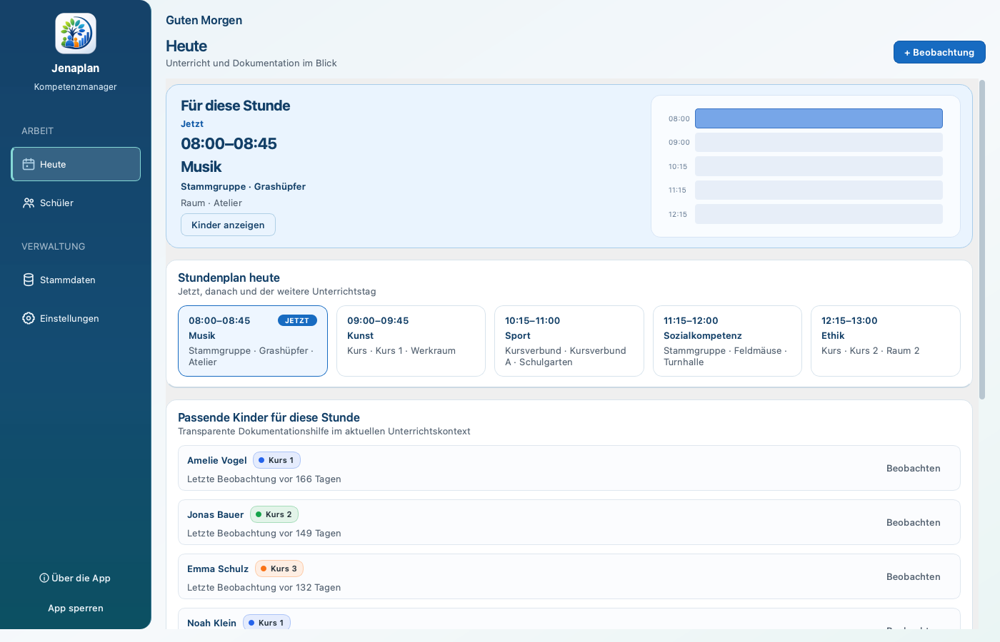

### Zweck und Aufbau

Das Dashboard `Heute` beantwortet drei Fragen:

1. Welche Stunde läuft jetzt oder steht als Nächstes an?
2. Welche Kinder passen zu diesem Unterrichtskontext?
3. Wo bestehen noch Dokumentationslücken?

Die Bereiche heißen `Für diese Stunde`, `Stundenplan heute`, `Passende Kinder für diese Stunde` und `Dokumentation im Überblick`.

### Aktuelle Stunde, nächste Stunde und Pausen

Eine laufende Stunde trägt den Hinweis `Jetzt`. Zwischen zwei Stunden zeigt das Dashboard die nächste Stunde als `Als Nächstes · heute`. Nach dem letzten Unterricht des Tages kann der nächste Unterrichtskontext eines folgenden Wochentags erscheinen. Unterrichtsfreie Zeit wird nicht als eigener Pauseneintrag gepflegt; sie ergibt sich aus der Lücke zwischen zwei Stunden.

Die hervorgehobene Stunde zeigt Uhrzeit, Fach, Zielart, Ziel und – sofern eingetragen – `Raum`. `Kinder anzeigen` öffnet die zugehörige Stammgruppe, den Kurs oder Kursverbund.

### Tagesstundenplan

`Stundenplan heute` zeigt die aktiven Einträge des Tages in zeitlicher Reihenfolge. Die aktuelle Stunde ist mit `JETZT` markiert. Ein Klick auf eine Stundenkarte öffnet den passenden Schülerkontext.

### Passende Kinder

`Passende Kinder für diese Stunde` zeigt Kinder aus der Stammgruppe, dem Kurs oder Kursverbund der hervorgehobenen Stunde. Die Auswahl ist eine transparente Dokumentationshilfe und keine Bewertung. Die Anzeige berücksichtigt den Unterrichtskontext und vorhandene Dokumentation; deshalb können besonders hilfreiche nächste Dokumentationsfälle oben erscheinen.

Mit `Beobachten` beginnt eine kindbezogene Beobachtung. `Alle Kinder anzeigen` öffnet die vollständige passende Gruppe. Das Kind erscheint hier, weil es dem Ziel der aktuellen beziehungsweise nächsten Stunde über Stammgruppe, Kurs oder Kursverbund zugeordnet ist.

### Dokumentation im Überblick

Die Matrix zeigt Stammgruppen und dokumentationsrelevante Fächer. Die Zahlen beschreiben neutrale Abdeckung, ausdrücklich `keine Leistung`. Ein Klick öffnet die jeweilige Stammgruppe beziehungsweise den fachlichen Blick auf ihre Kinder.

### Beobachtung aus dem Dashboard erfassen

1. Bei laufender oder nächster Stunde `+ Beobachtung` wählen.
2. In der geöffneten passenden Schülerliste beim gewünschten Kind `Beobachten` wählen. Bei der kindbezogenen Aktion im Dashboard entfällt dieser Zwischenschritt.
3. Das vorbelegte Fach und den `Beobachtungskontext` prüfen.
4. Beobachtung wie in Kapitel 8 vervollständigen.
5. `Speichern` wählen.

Nach dem Speichern wird die Beobachtung dem Kind zugeordnet. Profil, letzte Beobachtungen, Dokumentationsstand und Vorschläge können sich aktualisieren.

### Zustände ohne passende Stunde

- Ohne einen einzigen Stundenplaneintrag erscheint `Noch kein Stundenplan eingerichtet` und `Zu Einstellungen · Stundenplan`.
- Gibt es grundsätzlich einen Stundenplan, aber keine aktuelle oder nächste passende Stunde, erscheint `Keine aktive Stunde geplant`.
- Ein Tag ohne aktive Einträge zeigt einen entsprechenden Leerzustand und verweist auf `Einstellungen`.
- Die globale Beobachtungsaktion ist ohne hervorgehobenen Unterrichtskontext nicht als Stundenaktion verfügbar; eine Beobachtung kann weiterhin über `Schüler` gestartet werden.

## 8. Beobachtungen erfassen

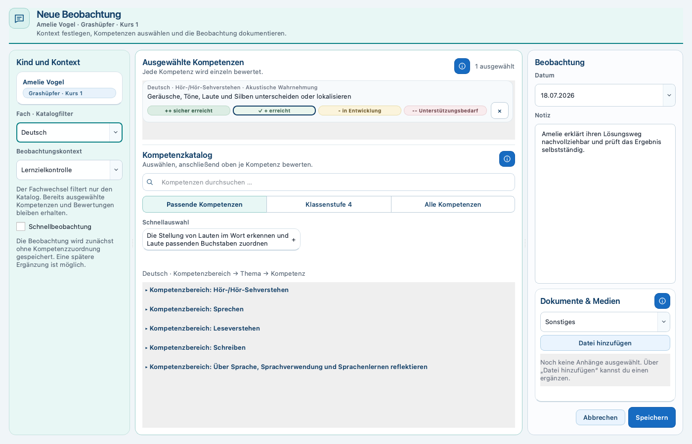

### Normale Beobachtung

**Wo finde ich sie?** Über `+ Beobachtung`, `Beobachten`, `Beobachtung erfassen` oder beim Bearbeiten einer bestehenden Beobachtung.

Der Dialog heißt `Neue Beobachtung` beziehungsweise `Beobachtung bearbeiten` und ist in `Kind und Kontext`, `Ausgewählte Kompetenzen`, `Kompetenzkatalog` und `Beobachtung` gegliedert.

#### Schritt für Schritt

1. Kind prüfen oder auswählen.
2. Unter `Fach · Katalogfilter` ein Fach wählen.
3. Einen `Beobachtungskontext` wählen: `Lernzielkontrolle`, `Präsentation`, `Einzelgespräch`, `Gruppenarbeit` oder `Leseübung`.
4. `Datum` prüfen.
5. Im `Kompetenzkatalog` über `Kompetenzen durchsuchen …`, `Schnellauswahl` oder die Hierarchie auswählen: Fach → Kompetenzbereich → Thema → Kompetenz.
6. Bei Bedarf zwischen `Passende Kompetenzen`, `Klassenstufe 4` und `Alle Kompetenzen` wechseln.
7. Jede ausgewählte Kompetenz einzeln bewerten: `++ sicher erreicht`, `+ erreicht`, `- in Entwicklung` oder `-- Unterstützungsbedarf`.
8. Eine pädagogisch verständliche `Notiz` ergänzen.
9. Optional unter `Dokumente & Medien` eine Datei hinzufügen und die Art auswählen, zum Beispiel `Arbeitsprobe`, `Lernzielkontrolle`, `Gesprächsnotiz`, `Bericht`, `Foto`, `Audio` oder `Sonstiges`.
10. `Speichern` wählen.

Ein Fachwechsel filtert nur den Katalog. Bereits ausgewählte Kompetenzen und ihre Bewertungen bleiben erhalten; dadurch ist eine fachübergreifende Beobachtung möglich.

Die Pastellfarben unterstützen die Orientierung zwischen den vier Bewertungsstufen. Text, Symbol und sichtbarer Auswahlzustand bleiben maßgeblich; Farbe ist nicht der alleinige Informationsträger. Die Farben bedeuten weder eine Schulnote noch eine automatische Gesamtbewertung.

**Nach dem Speichern:** Die App meldet `Beobachtung wurde gespeichert.` beziehungsweise bei einer Änderung, dass die Beobachtung aktualisiert wurde. Der Eintrag erscheint im Schülerprofil und kann Dokumentationszustände, Vorschläge und Berichtsvorbereitungen beeinflussen.

**Wichtige Regel:** Eine normale Beobachtung benötigt mindestens eine ausgewählte und bewertete Kompetenz. Andernfalls erscheint `Bitte mindestens eine Kompetenz mit Bewertung auswählen.`

### Schnellbeobachtung

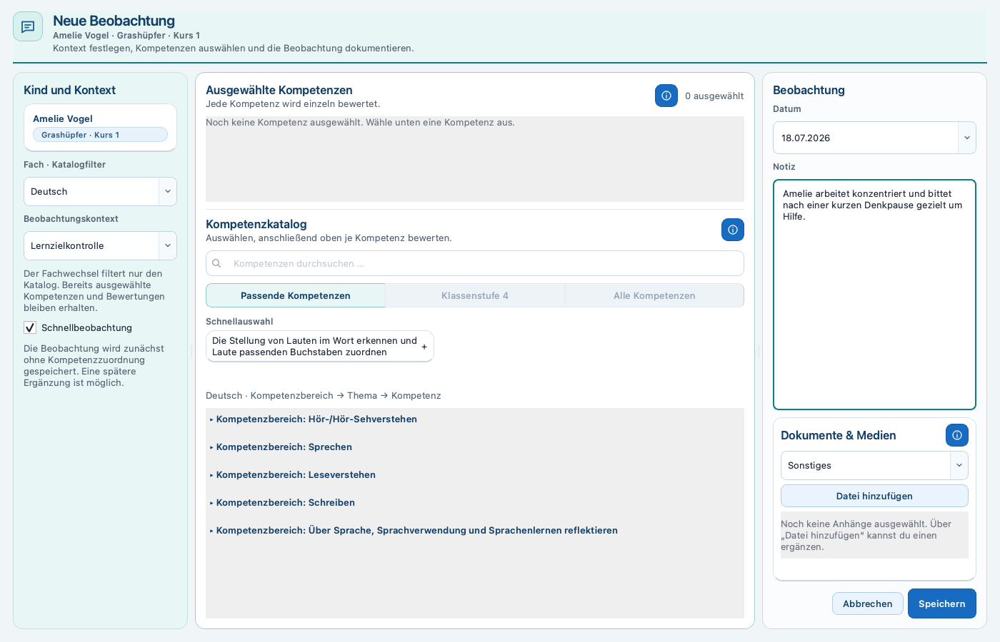

Eine Schnellbeobachtung hält zunächst nur eine kurze Wahrnehmung fest. Sie eignet sich für den Unterrichtsmoment, wenn die Kompetenzzuordnung später erfolgen soll.

1. Beobachtungsdialog öffnen.
2. Kind, Fach, `Beobachtungskontext` und `Datum` prüfen.
3. `Schnellbeobachtung` aktivieren.
4. Eine aussagekräftige `Notiz` eingeben.
5. `Speichern` wählen.

Bei aktivierter Schnellbeobachtung ist der Kompetenzkatalog gesperrt. Sind bereits Kompetenzen ausgewählt, müssen sie zuerst entfernt werden. Ohne Notiz erscheint `Bitte eine Notiz für die Schnellbeobachtung eingeben.`

**Nach dem Speichern:** Die Beobachtung erscheint mit dem Hinweis auf eine Schnellbeobachtung im Profil. Sie kann später über `Bearbeiten` um Kompetenzen und Bewertungen ergänzt werden.

### Bestehende Beobachtung bearbeiten oder ausblenden

Im Profilbereich `Beobachtungen` öffnet `Bearbeiten` den vorhandenen Eintrag. Nach dem Speichern bleibt die Beobachtung dieselbe fachliche Dokumentation, nun mit den geänderten Angaben.

`Löschen` fragt `Diese Beobachtung aus dem Profil ausblenden?`. Die Beobachtung wird fachlich deaktiviert und verschwindet aus den aktuellen Ansichten. Bereits in historischen Revisionen gespeicherte Inhalte werden dadurch nicht nachträglich verändert.

### Historische oder nicht mehr verfügbare Referenzen

Eine bereits gespeicherte, inzwischen nicht mehr aktive Kompetenz kann beim Bearbeiten als `Historischer Bestand` sichtbar bleiben. Sie darf nicht neu ausgewählt werden. Dadurch bleibt die frühere Dokumentation nachvollziehbar, ohne die Kompetenz wieder für neue Beobachtungen freizugeben.

Ein in einem Bericht oder LEG gespeicherter Beobachtungsbeleg kann später als nicht mehr verfügbar markiert sein. Die Referenz bleibt sichtbar, kann aber eine Finalisierung oder einen Gesprächsabschluss blockieren, bis sie bewusst abgewählt oder wieder fachlich verfügbar gemacht wurde.

### Was nicht möglich ist

- Keine automatische Bewertung aus der Notiz.
- Keine automatische Auswahl einer Kompetenz.
- Keine normale Beobachtung ohne bewertete Kompetenz.
- Keine Schnellbeobachtung ohne Notiz.
- Keine neue Auswahl historischer, inaktiver Kompetenzen.
- Kein Wiederherstellen einer ausgeblendeten Beobachtung über eine sichtbare Benutzerfunktion.

## 9. Schülerprofil

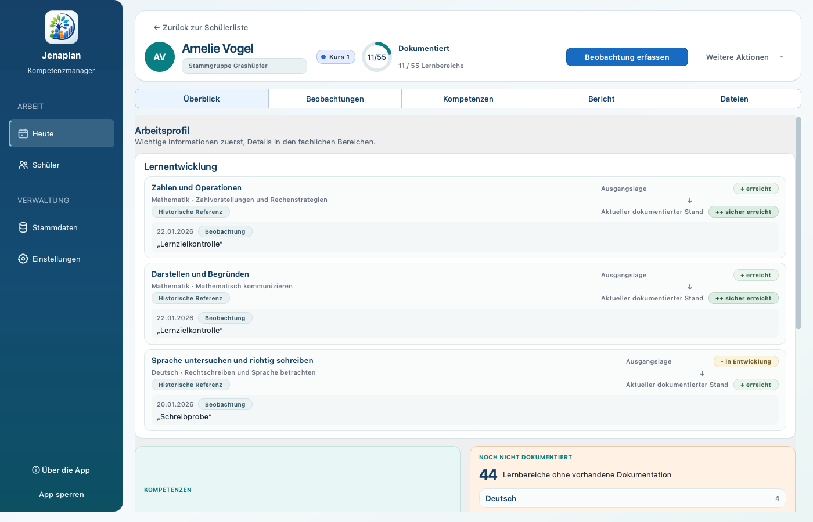

### Profilkopf

Der Kopf zeigt Name, Stammgruppe, Kurs und den aktuellen Dokumentationsstand. `Beobachtung erfassen` startet eine neue Beobachtung. `Weitere Aktionen` enthält `Schüler bearbeiten`, `Datei hinzufügen`, `Bericht öffnen` und `Lernentwicklungsgespräch öffnen`.

Stammgruppe und Kurs sind Zuordnungen des Kindes. Änderungen erfolgen über `Schüler bearbeiten`; dort stehen `Vorname`, `Nachname`, `Stammgruppe`, `Kurs` und `Notiz` zur Verfügung.

### `Überblick`

Das `Arbeitsprofil` bündelt:

- `Lernentwicklung`: ausgewählte dokumentierte Entwicklungen mit `Ausgangslage` und `Aktueller dokumentierter Stand`.
- `KOMPETENZEN`: Zugang zum Kompetenz-Cockpit.
- `NOCH NICHT DOKUMENTIERT`: Lernbereiche ohne vorhandene Dokumentation.
- `Neueste Beobachtungen`: schneller Blick auf die jüngsten Einträge.

Die Entwicklungsdarstellung zeigt dokumentierte pädagogische Zustände und einen zugehörigen Beleg. Sie berechnet keine Note, keinen Punktwert und keine Leistungsrangfolge. Ein älterer Katalogbezug kann als `Historische Referenz` erscheinen.

`Kompetenz-Cockpit öffnen` wechselt zu `Kompetenzen`. `Offene Bereiche ansehen` öffnet die noch nicht dokumentierten Bereiche.

### `Beobachtungen`

Über `Kontext, Notiz oder Kompetenz suchen` sowie die Filter nach Fach und Bewertung lässt sich die Liste eingrenzen. `Zurücksetzen` entfernt die Filter.

Zunächst werden die drei neuesten Beobachtungen gezeigt. `Alle Beobachtungen anzeigen (N)` erweitert die Liste; `Weniger anzeigen` reduziert sie wieder. Eine Karte kann `Details anzeigen`, `Bearbeiten` und `Löschen` anbieten.

### `Kompetenzen` und themenbezogene Entwicklung

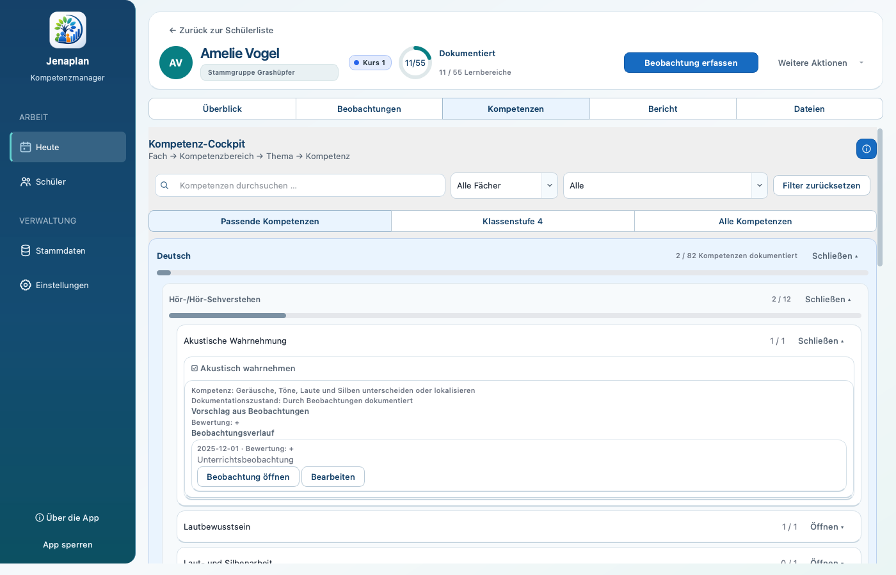

Das `Kompetenz-Cockpit` folgt Fach → Kompetenzbereich → Thema → Kompetenz. Fachkarten zeigen, wie viele Kompetenzen dokumentiert sind. `Öffnen ▾` klappt die nächste Ebene auf; `Schließen ▴` klappt sie zu.

Die Ansicht kann mit `Kompetenzen durchsuchen …`, `Alle Fächer`, dem Dokumentationsstatus und `Passende Kompetenzen`, `Klassenstufe 4` oder `Alle Kompetenzen` gefiltert werden. `Filter zurücksetzen` stellt den Gesamtblick wieder her.

Die Statusauswahl unterscheidet:

- `Dokumentiert`
- `Noch nicht dokumentiert`
- `Beobachtet, noch nicht bestätigt`
- `Bestätigter Stand`
- `Neuere Beobachtungen nach Bestätigung`

In einer geöffneten Kompetenz stehen `Dokumentationszustand`, ein möglicher `Bestätigter Stand`, ein `Vorschlag aus Beobachtungen` und der `Beobachtungsverlauf`. Mit `Beobachtung öffnen` oder `Bearbeiten` gelangt die Lehrkraft zum Beleg.

`Nicht dokumentiert` beziehungsweise `Noch nicht dokumentiert` bedeutet: Für den betrachteten Bereich liegt keine aktive Beobachtung oder Bestätigung vor. Es bedeutet nicht „nicht gekonnt“, „nicht erreicht“ oder eine negative Bewertung.

Historisch dokumentierte Kompetenzen bleiben in einem getrennten historischen Bereich sichtbar. Sie sind dort zur Nachvollziehbarkeit lesbar, aber nicht wieder für neue Dokumentation aktiviert.

### `Bericht`

Der Profilbereich `Bericht` zeigt eine aus aktuellen Profildaten abgeleitete `Berichtsvorschau`. `Bericht erstellen` öffnet die Berichtswerkstatt. `Bericht kopieren` übernimmt den vorbereiteten Text in die Zwischenablage; `Als Text exportieren` speichert eine Text-/Markdown-Fassung.

Diese Profilvorschau ist kein finalisierter Lernentwicklungsbericht und keine Revision.

### `Dateien`

Unter `Dokumente & Medien` können Dateien über `+ Datei hinzufügen` referenziert werden. `Öffnen` ruft die lokale Datei auf. `Entfernen` blendet die Dokumentreferenz aus der aktuellen Ansicht aus.

Die Datei bleibt eine lokale Datei des Arbeitsplatzes. Die App ist kein Dokumentenarchiv mit Cloud-Speicher oder Wiederherstellungsdienst.

### Empty States, Tastatur und Scrollen

Ohne passende Daten erklärt die jeweilige Ansicht, dass noch keine Beobachtungen, Kompetenzen, Dokumente oder Berichtsinhalte vorhanden sind, und bietet – soweit sinnvoll – eine nächste Aktion an.

Die Profilbereiche und Schaltflächen sind über die normale Tab-Reihenfolge erreichbar. Aufklappbare Karten im Kompetenz-Cockpit lassen sich neben dem Mausklick auch mit Eingabetaste oder Leertaste öffnen und schließen. Bei einer Aktualisierung desselben Profils bleiben ausgewählter Bereich, Filter und Scrollposition soweit möglich erhalten. Beim Wechsel zu einem anderen Kind beginnt das Profil wieder im `Überblick`.

### Was nicht möglich ist

- Keine automatische Note oder Leistungsprognose.
- Keine Bearbeitung historischer Kompetenzbestände als aktuelle Katalogeinträge.
- Keine Wiederherstellung entfernter Dokumentreferenzen über eine sichtbare Funktion.
- Keine Rollen- oder Freigabesteuerung je Profil.

## 10. Lernentwicklungsbericht

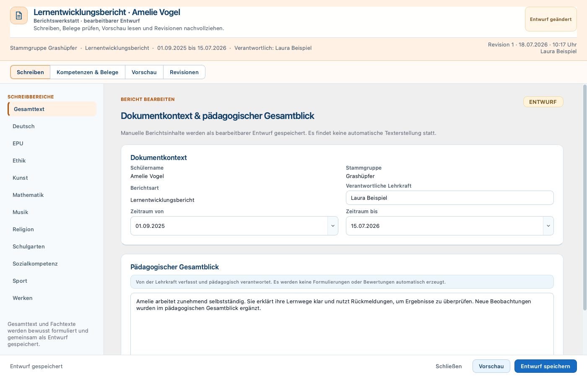

### Berichtsentwurf öffnen oder anlegen

`Bericht öffnen` unter `Weitere Aktionen` oder `Bericht erstellen` im Profilbereich `Bericht` öffnet die `Berichtswerkstatt · bearbeitbarer Entwurf`.

Existiert für das Kind bereits ein gespeicherter Berichtsentwurf, wird der aktuelle Entwurf wieder geöffnet. Existiert noch keiner, beginnt die Werkstatt mit einem neuen, noch zu speichernden Entwurf. Die aktuelle Oberfläche besitzt keine Auswahl mehrerer Berichtsentwürfe und keine sichtbare Aktion `Neuer Berichtsentwurf`.

### `Schreiben`

Im `Dokumentkontext & pädagogischer Gesamtblick` werden angezeigt beziehungsweise gepflegt:

- Schülername und Stammgruppe
- Berichtstyp `Lernentwicklungsbericht`
- `Zeitraum von` und `Zeitraum bis`
- `Verantwortliche Lehrkraft`
- `Pädagogischer Gesamtblick`

Der Berichtstyp wird angezeigt und ist in der aktuellen Oberfläche nicht auswählbar. Das Enddatum muss nach dem Anfangsdatum liegen.

Für jedes verwendete Fach stehen die Textbereiche `Stärken`, `Lernentwicklung`, `Unterstützungsbedarf` und `Nächste Ziele` bereit. Die Texte werden von der Lehrkraft verfasst; es findet keine automatische Textgenerierung statt.

### `Kompetenzen & Belege`

1. Ein Fach öffnen.
2. `Fach im Bericht verwenden` aktivieren.
3. Passende Kompetenzen auswählen.
4. Beobachtungsbelege auswählen.
5. Bei Bedarf Diagramme aktivieren.

Verfügbar sind die neutralen Darstellungen `Dokumentationsabdeckung`, `Kompetenzentwicklung mit Einzelständen` und `Zeitachse ausgewählter Beobachtungen`. Sie unterstützen die pädagogische Einordnung; sie berechnen keine Note und keinen Leistungstrend.

Eine historische Kompetenz kann in einem bestehenden Entwurf erhalten bleiben, aber nicht neu ausgewählt werden. Ein gespeicherter, inzwischen nicht mehr verfügbarer Beobachtungsbeleg bleibt sichtbar. Er muss vor einer Finalisierung bewusst geklärt werden.

### Speichern und Wiederöffnen

`Entwurf speichern` speichert Texte, Zeitraum, Lehrkraft, Fachauswahl, Kompetenzen, Belege und Diagrammauswahl. Ein späteres Öffnen des Berichts führt wieder zu diesem Entwurf.

`Schließen` mit ungespeicherten Änderungen löst eine Rückfrage aus. `Weiter bearbeiten` kehrt zum Entwurf zurück, `Änderungen verwerfen` schließt ohne die letzten Änderungen.

### `Vorschau` und Entwurfs-PDF

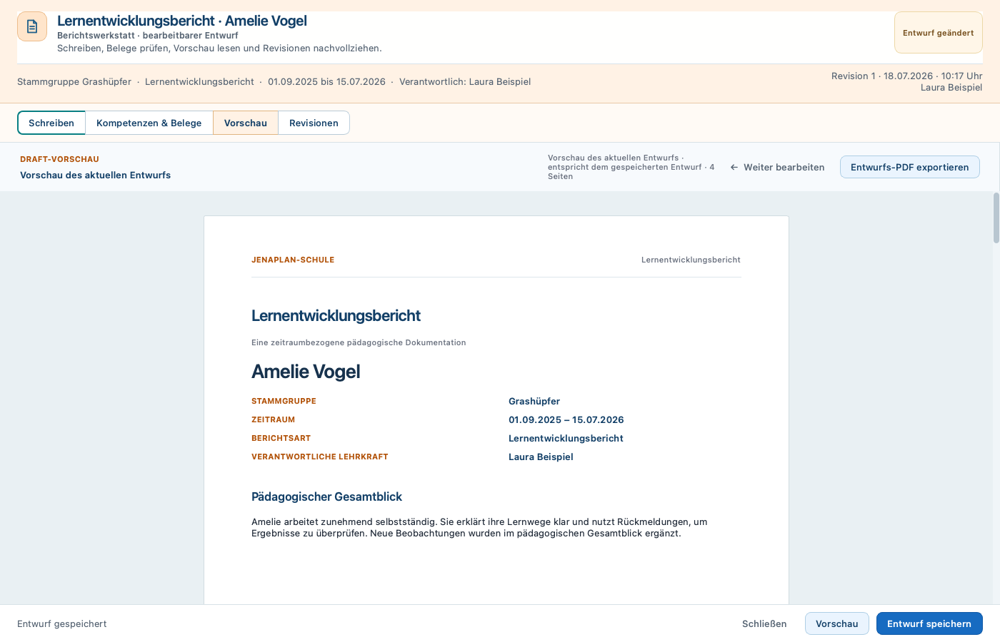

`Vorschau` zeigt die `Vorschau des aktuellen Entwurfs`. Die Ansicht weist darauf hin, ob sie dem gespeicherten Entwurf entspricht oder ungespeicherte Änderungen enthält.

`Entwurfs-PDF exportieren` erzeugt ein PDF aus dem aktuellen Entwurfsstand. Für ein Entwurfs-PDF muss mindestens ein Fach verwendet werden. Das PDF wird über einen Dateidialog an einem gewählten Ort gespeichert.

Das Entwurfs-PDF ist eine Arbeitsausgabe. Es ist nicht schreibgeschützt, nicht Teil der Revisionshistorie und kann von späteren Entwurfsänderungen abweichen.

### Hinweise und Grenzen

- Ein Bericht kann ohne ausgewählte Kompetenz weiterbearbeitet werden, benötigt für die Finalisierung aber mindestens ein verwendetes Fach und mindestens einen manuell verfassten Text.
- Nicht verfügbare ausgewählte Belege verhindern die Finalisierung.
- Es gibt kein automatisches Speichern während des Schreibens.
- Es gibt keine automatische Textformulierung.
- Die aktuelle Oberfläche bietet keinen komfortablen Wechsel zwischen mehreren Berichtsentwürfen desselben Kindes.

## 11. Bericht finalisieren und Revisionen

### Status verstehen

- `Entwurf`: Es existiert noch keine finale Revision.
- `Finalisiert · Revision X`: Der gespeicherte Entwurf entspricht der aktuellen finalen Revision.
- `Entwurf geändert`: Seit der letzten Finalisierung wurde der bearbeitbare Entwurf verändert.

### Erste Finalisierung oder Folgerevision

Im Bereich `Revisionen` heißt die Aktion `Bericht finalisieren` oder nach einer Änderung `Neue Revision finalisieren`.

1. Entwurf vollständig prüfen.
2. `Entwurf speichern`.
3. Zu `Revisionen` wechseln.
4. `Bericht finalisieren` beziehungsweise `Neue Revision finalisieren` wählen.
5. Die Zusammenfassung zu Kind, Berichtstyp, Zeitraum, Fächern, Kompetenzen, Beobachtungen und neuer Revisionsnummer prüfen.
6. `Verantwortliche Lehrkraft` prüfen beziehungsweise eintragen.
7. `Ich habe den Bericht geprüft und möchte ihn als unveränderliche Revision finalisieren.` aktivieren.
8. Finalisierung bestätigen.

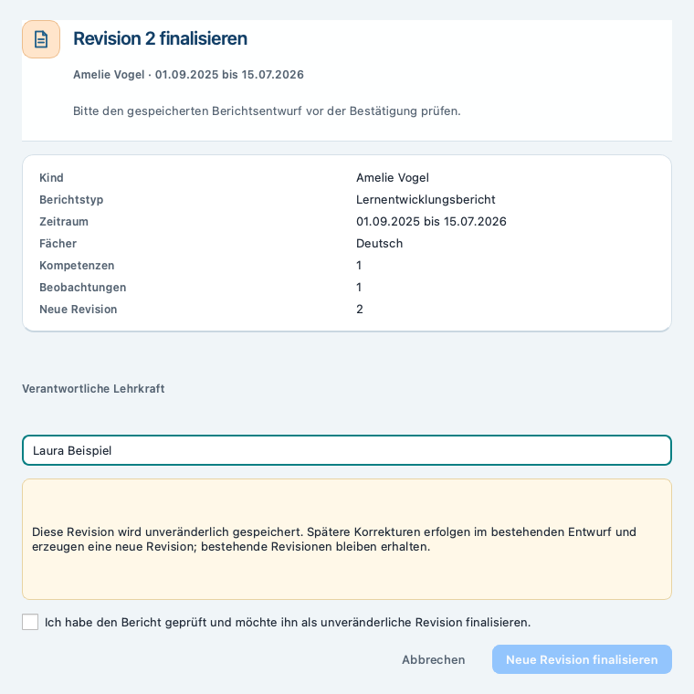

Vor der Finalisierung prüft die App unter anderem Zeitraum, verwendete Fächer, manuelle Texte und Referenzen. Fehler werden als verständliche Hinweise angezeigt; die Revision entsteht erst nach erfolgreicher Prüfung und ausdrücklicher Bestätigung.

### Schutz bei geändertem Zeitraum oder Berichtstyp

Nach der ersten Finalisierung gehören Berichtstyp und Zeitraum zur Identität der Revisionsreihe. Weicht der bearbeitete Entwurf davon ab, wird eine Folgerevision blockiert. Für einen anderen Zeitraum oder Berichtstyp ist fachlich ein neuer Berichtsentwurf erforderlich.

**Aktuelle Produktgrenze:** Die UI bietet derzeit keine sichtbare Funktion, einen zweiten neuen Berichtsentwurf für dasselbe Kind anzulegen oder auszuwählen. Die Sperre schützt zwar die bestehende Revisionsreihe, der neue Entwurf kann aber nicht vollständig über den aktuellen Benutzerfluss angelegt werden.

### Revisionshistorie

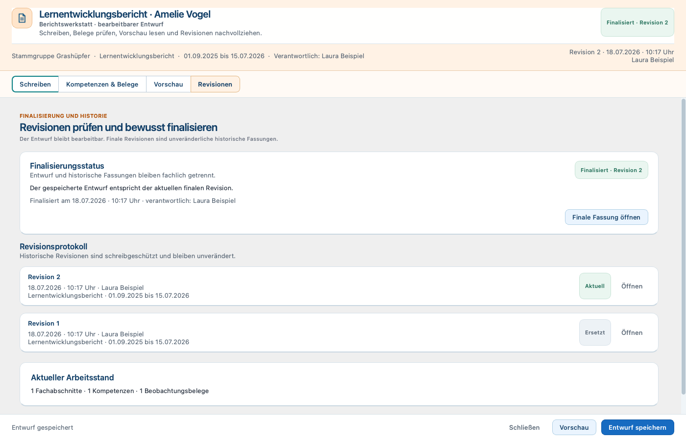

Das `Revisionsprotokoll` zeigt die neuesten Revisionen zuerst. Die neueste Revision trägt `Aktuell`, ältere Revisionen `Ersetzt`. `Öffnen` zeigt eine Revision schreibgeschützt. `Finale Fassung öffnen` öffnet die aktuelle Revision.

Eine Folgerevision überschreibt ältere Revisionen nicht. Der bearbeitbare Entwurf bleibt bestehen und kann erneut geändert werden.

### Schreibgeschützte Revisionsansicht und finales PDF

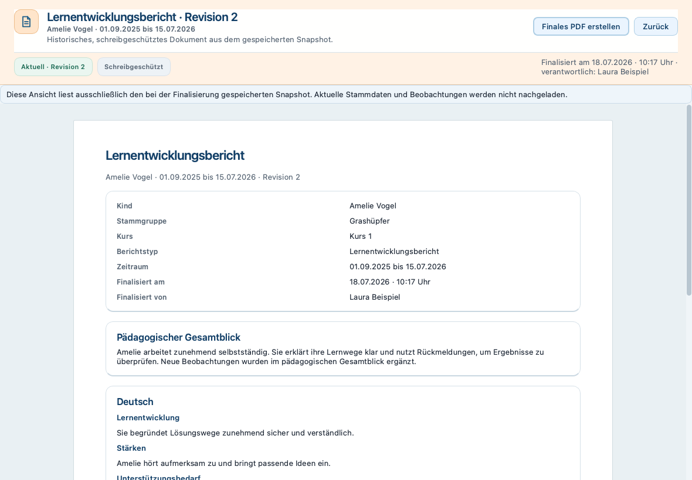

Eine Revision trägt `Schreibgeschützt` und zeigt ausschließlich den bei der Finalisierung gespeicherten Stand. Spätere Änderungen an Stammdaten, Beobachtungen oder Entwurf werden nicht nachgeladen.

Nur die mit `Aktuell` markierte Revision bietet `Finales PDF erstellen`. Das finale PDF wird manuell erzeugt und als verwaltetes, unveränderliches Ausgabedokument der aktuellen Revision gespeichert. Eine bereits vorhandene finale Ausgabe wird entsprechend angezeigt.

**Wichtig:** Die Finalisierung selbst erzeugt nicht automatisch ein PDF. Eine mit `Ersetzt` markierte ältere Revision kann geöffnet, aber nicht nachträglich über die UI als neues finales PDF ausgegeben werden.

### Entwurfs-PDF und finales PDF im Vergleich

| Merkmal | Entwurfs-PDF | Finales PDF |
|---|---|---|
| Quelle | aktueller Entwurf | aktuelle unveränderliche Revision |
| Erzeugung | `Entwurfs-PDF exportieren` | `Finales PDF erstellen` |
| Zeitpunkt | jederzeit bei gültigem Entwurf | erst nach Finalisierung |
| Ablage | frei gewählter Dateipfad | verwaltete lokale Ausgabedatei |
| Historischer Schutz | nein | ja, an die Revision gebunden |

## 12. Lernentwicklungsgespräch

### LEG-Draft anlegen und öffnen

`Lernentwicklungsgespräch öffnen` liegt im Schülerprofil unter `Weitere Aktionen`. Gibt es noch keinen Draft, wird eine neue Gesprächsvorbereitung geöffnet. Gibt es mehrere Drafts, erscheint `Lernentwicklungsgespräch auswählen` mit `Öffnen`, `Neuer Draft` und `Schließen`.

Der geöffnete Arbeitsstand trägt `Bearbeitbarer Entwurf`. `Entwurf gespeichert` bestätigt, dass der sichtbare Stand gespeichert ist. Ein ungespeicherter Stand wird beim Schließen geschützt.

### Die sechs Gesprächsphasen

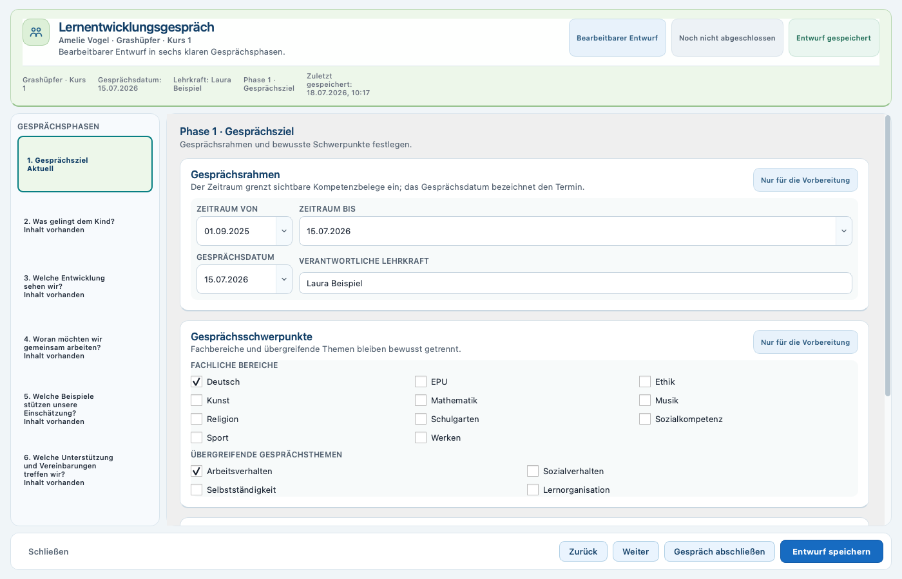

1. `Gesprächsziel`
2. `Was gelingt dem Kind?`
3. `Welche Entwicklung sehen wir?`
4. `Woran möchten wir gemeinsam arbeiten?`
5. `Welche Beispiele stützen unsere Einschätzung?`
6. `Welche Unterstützung und Vereinbarungen treffen wir?`

`Zurück` und `Weiter` wechseln zwischen den Phasen. Die linke Phasennavigation erlaubt den direkten Sprung. Die Kennzeichnungen `Nur für die Vorbereitung`, `Im Gespräch bearbeiten` und `Im Entwurf als Vereinbarung festgehalten` helfen, interne Vorbereitung und gemeinsam festgehaltene Ergebnisse auseinanderzuhalten.

### Phase 1 – Gesprächsziel

Unter `Gesprächsrahmen` können `Zeitraum von`, `Zeitraum bis`, `Gesprächsdatum` und `Verantwortliche Lehrkraft` gepflegt werden. Unter `Gesprächsschwerpunkte` lassen sich fachliche Bereiche und übergreifende Themen wie `Arbeitsverhalten`, `Sozialverhalten`, `Selbstständigkeit` und `Lernorganisation` auswählen. Ein Gesprächseinstieg kann vorbereitet werden.

Der Zeitraum grenzt die sichtbaren Kompetenzbelege ein. Das `Gesprächsdatum` bezeichnet den tatsächlichen Termin.

### Phasen 2 bis 4 – Stärken, Entwicklung und Ziele

- In `Was gelingt dem Kind?` werden die Sicht des Kindes und beobachtete Stärken vorbereitet.
- In `Welche Entwicklung sehen wir?` werden Lehrkraftsicht und Entwicklungsfelder festgehalten.
- In `Woran möchten wir gemeinsam arbeiten?` bleiben vorbereitete Ziele und im Gespräch gemeinsam formulierte Ziele getrennt.

Diese Trennung verhindert, dass interne Vorüberlegungen unbemerkt als gemeinsam vereinbart erscheinen.

### Phase 5 – Kompetenzen, Belege und Diagramme

Kompetenzen und Beobachtungsbelege können fachbezogen ausgewählt und durchsucht werden. `Belege ansehen` öffnet den Belegblick auch aus anderen Gesprächsphasen.

Diagramme dienen der Gesprächsvorbereitung und Einordnung. Werden mehr als fünf Belege ausgewählt, erscheint ein Hinweis; die Auswahl wird nicht automatisch gekürzt. Historische Kompetenzen bleiben erkennbar. Ein gespeicherter, nicht mehr verfügbarer Beleg bleibt sichtbar und muss vor dem Abschluss geklärt werden.

### Phase 6 – Unterstützung und Vereinbarungen

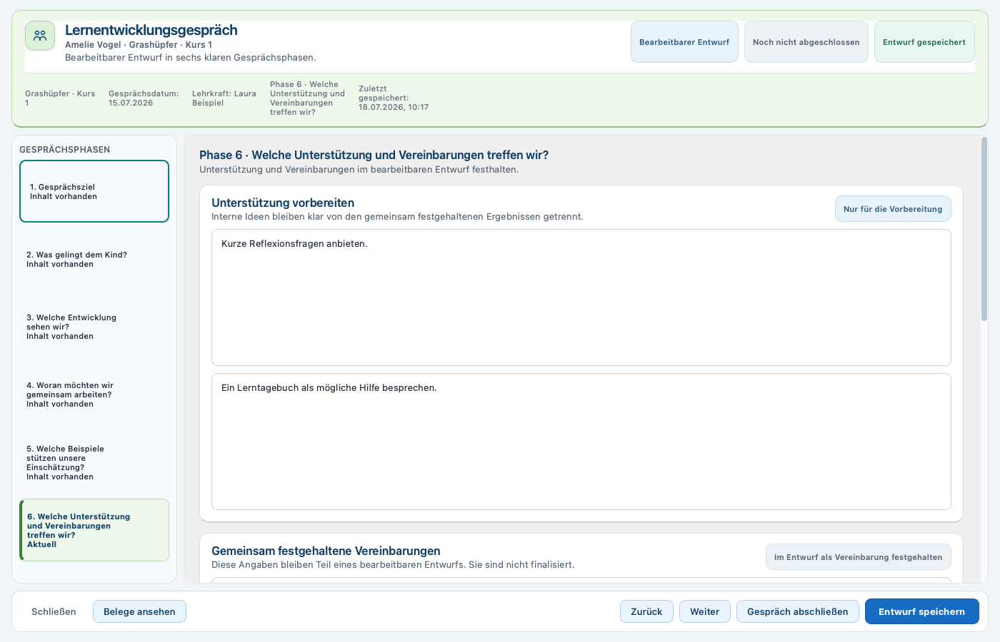

`Unterstützung vorbereiten` und vorbereitete Vereinbarungen sind interne Arbeitsfelder. Davon getrennt werden gemeinsam festgehalten:

- gemeinsam vereinbarte Ziele
- gemeinsam vereinbarte Unterstützung
- Maßnahmen und Vereinbarungen
- Zuständigkeiten
- `Optionaler Überprüfungstermin`

### Speichern und wieder öffnen

`Entwurf speichern` speichert alle sechs Phasen, Auswahl und Gesprächsrahmen. Beim nächsten Öffnen steht derselbe Draft wieder zur Verfügung. Beim Schließen eines geänderten Drafts stehen `Weiter bearbeiten`, `Änderungen verwerfen` und `Entwurf speichern` zur Verfügung.

### Gespräch abschließen, Revisionen und PDF

Die aktuelle produktive App kann ein LEG abschließen und versionieren. Der Abschluss ist also nicht mehr nur geplant.

1. `Gesprächsdatum` und `Verantwortliche Lehrkraft` eintragen.
2. Mindestens ein gemeinsam festgehaltenes Ergebnis bei Ziel, Unterstützung oder Vereinbarung erfassen.
3. Historische beziehungsweise nicht verfügbare Referenzen prüfen.
4. `Entwurf speichern`.
5. `Gespräch abschließen` wählen.
6. Zusammenfassung und ausdrückliche Bestätigung prüfen.
7. Abschluss bestätigen.

Der Status wechselt von `Noch nicht abgeschlossen` zu `Abgeschlossen · Revision X`. Wird der Draft danach bearbeitet, erscheint `Entwurf seit Abschluss geändert · Revision X`. Ein erneuter Abschluss erzeugt eine weitere unveränderliche Revision; ältere Revisionen bleiben `Ersetzt`, die neueste ist `Aktuell`.

`Revisionen` öffnet die `LEG-Abschlussrevisionen`. `Öffnen` zeigt die gewählte Revision schreibgeschützt. Die Abschlussrevision enthält die gemeinsam festgehaltenen Gesprächsergebnisse, nicht die gesamte interne Vorbereitung.

Nur die aktuelle Abschlussrevision kann über `Finales PDF erstellen` als finales LEG-PDF ausgegeben werden. Der Gesprächsabschluss erzeugt das PDF nicht automatisch. Ersetzte Revisionen bleiben lesbar, bieten aber keine neue finale PDF-Erzeugung.

### Was nicht möglich ist

- Keine stille Änderung einer abgeschlossenen Revision.
- Kein automatisches PDF beim Abschluss.
- Kein finales PDF aus einer ersetzten LEG-Revision.
- Keine gemeinsame Bearbeitung über mehrere Geräte.
- Keine Rollen- oder Freigabefunktion.
- Vorbereitungsdiagramme und interne Notizen werden nicht als vollständige Gesprächsakte in die Abschlussrevision übernommen.

## 13. Stundenplan

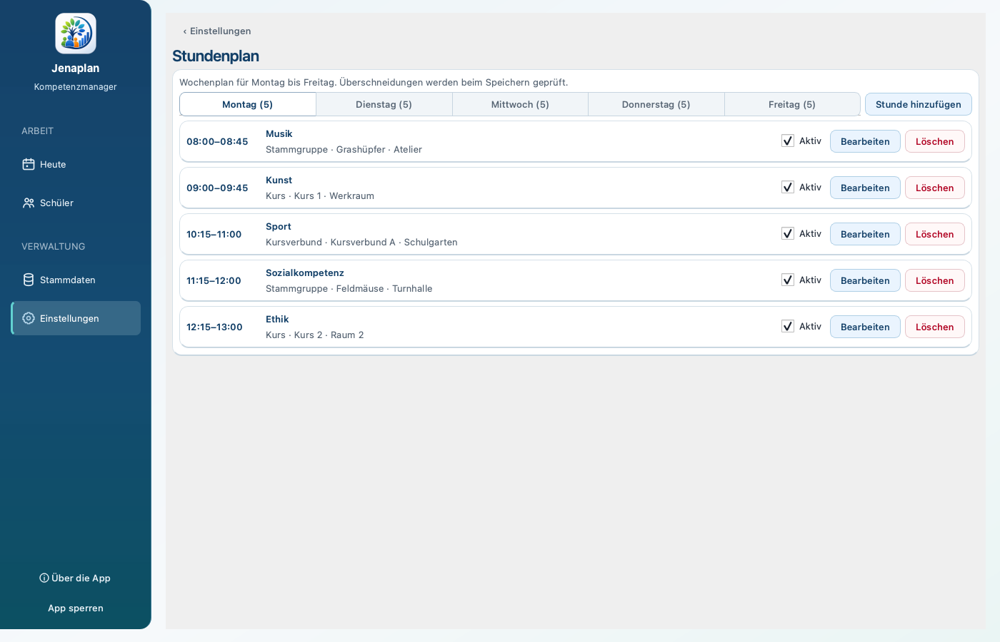

### Stundenplan öffnen

`Einstellungen` öffnet den Bereich `Stundenplan`. Die Wochentage `Montag` bis `Freitag` werden als Register gezeigt. Die Zahl am Wochentag gibt die vorhandenen Einträge an.

### Stunde anlegen

1. Gewünschten Wochentag wählen.
2. `Stunde hinzufügen` wählen.
3. Im Dialog `Stunde anlegen` den Wochentag prüfen.
4. `Beginn` und `Ende` eintragen.
5. `Fach` auswählen.
6. Als `Zielart` `Stammgruppe`, `Kurs` oder `Kursverbund` wählen.
7. Das konkrete `Ziel` auswählen.
8. Optional `Raum/Ort` eintragen.
9. `Eintrag aktiv` prüfen.
10. Speichern.

Die App prüft, dass Beginn vor Ende liegt und sich aktive Stunden nicht überschneiden. Fach und Ziel müssen vorhanden sein. Bei einer Überschneidung weist die App auf den kollidierenden Eintrag hin.

### Bearbeiten, deaktivieren, reaktivieren und löschen

- `Bearbeiten` öffnet `Stundenplaneintrag bearbeiten`.
- Das Kontrollfeld `Aktiv` deaktiviert oder reaktiviert einen Eintrag unmittelbar.
- `Löschen` fragt `Diesen Stundenplaneintrag wirklich löschen?` und entfernt ihn aus dem sichtbaren Wochenplan.

Ein deaktivierter Eintrag bleibt in `Einstellungen` sichtbar und kann wieder aktiviert werden. Ein gelöschter Eintrag ist über die UI nicht wiederherstellbar.

### Wirkung auf das Dashboard

Nur aktive, nicht gelöschte Stunden erscheinen auf `Heute`. Änderungen an Zeit, Fach, Ziel oder Raum wirken sich auf hervorgehobene Stunde, Tagesstundenplan, passende Kinder und Vorbelegung der Beobachtungsaktion aus.

Wird eine laufende oder kommende Stunde deaktiviert, verschwindet sie aus dem Dashboard. Je nach verbleibendem Plan wird die nächste aktive Stunde hervorgehoben oder `Keine aktive Stunde geplant` angezeigt.

### Grenzen

- Nur Montag bis Freitag.
- Keine eigenen Pauseneinträge.
- Keine Vertretungsplanung, Raumkonfliktverwaltung oder Kalender-Synchronisation.
- Keine Wiederherstellung gelöschter Stunden über die Oberfläche.

## 14. Stammdaten und Einstellungen

### Stammgruppen und Kurse

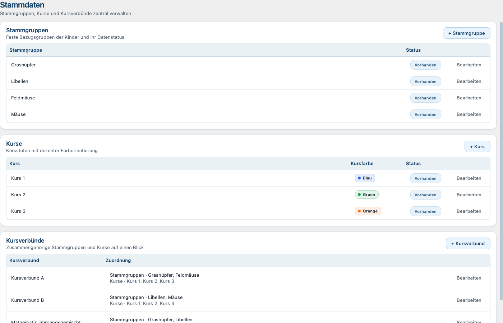

Unter `Stammdaten` stehen die Bereiche:

- `Stammgruppen` mit `+ Stammgruppe`
- `Kurse` mit `+ Kurs`

`Bearbeiten` ändert Namen. Kurse erhalten eine `Farbe`; verfügbar sind `Blau`, `Grün`, `Orange`, `Gelb`, `Lila`, `Rot` und `Grau`.

Ein Name darf nicht leer sein. Nach erfolgreicher Änderung meldet die App `Stammdaten wurden gespeichert.` und lädt die betroffenen Listen und Auswahlfelder neu.

Der sichtbare Status `Vorhanden` ist eine Bestandsanzeige. Für Stammgruppen und Kurse gibt es derzeit keine sichtbare Deaktivierungs- oder Löschfunktion.

### Kursverbünde

Unter `Stammdaten` steht außerdem `Kursverbünde` mit `+ Kursverbund`. Kursverbünde bündeln vorhandene Stammgruppen und Kurse. `Bearbeiten` ändert den Namen beziehungsweise die Zuordnungen.

Ein Kursverbund benötigt mindestens eine Stammgruppe und mindestens einen Kurs; ein bereits vorhandener Name wird mit `Ein Kursverbund mit diesem Namen existiert bereits.` abgelehnt. Nach erfolgreicher Änderung meldet die App `Stammdaten wurden gespeichert.` und lädt die betroffenen Listen und Auswahlfelder neu.

Der sichtbare Status `Vorhanden` ist eine Bestandsanzeige. Für Kursverbünde gibt es derzeit keine sichtbare Deaktivierungs- oder Löschfunktion.

### Kinder

**Voraussetzung: Vor dem Anlegen eines Kindes müssen mindestens eine Stammgruppe und ein Kurs vorhanden sein.**

Kinder werden unter `Schüler` gepflegt, nicht unter `Stammdaten`. `Schüler anlegen` erfasst `Vorname`, `Nachname`, `Stammgruppe`, `Kurs` und `Notiz`. Im Profil öffnet `Schüler bearbeiten` dieselben Angaben zur Änderung.

Die Schülerliste kann über `Schüler suchen …` gefiltert werden. Sie zeigt unter anderem `Name`, `Kurs`, `Dokumentation` und `Aktion`.

Vor- beziehungsweise Nachname sowie Stammgruppe und Kurs werden geprüft. Mögliche Hinweise sind `Bitte einen Namen eingeben.`, `Bitte eine Stammgruppe auswählen.` und `Bitte einen Kurs auswählen.` Nach erfolgreichem Speichern werden Schülerliste, Zuordnungen und Profil neu geladen.

**Nicht vorhanden:** Eine sichtbare Funktion zum Deaktivieren, Archivieren oder Löschen eines Kindes.

### Fächer und Kompetenzen beziehungsweise Lehrplan

Fächer, Kompetenzbereiche, Themen und Kompetenzen stammen aus dem eingebundenen Lehrplankatalog. Sie werden in Beobachtung, Profil, Bericht und LEG nur als fachliche Auswahl verwendet.

**Nicht vorhanden:** Eine produktive UI zum Anlegen, Umbenennen, Aktivieren oder Deaktivieren von Fächern und Kompetenzen. Katalogpflege ist kein normaler Administrationsablauf in der App.

### Dokumentationsrelevante Fächer

Unter `Einstellungen` folgt unterhalb des Stundenplans `Dokumentationsrelevante Fächer`. Die Auswahl bestimmt, welche Fächer in Dokumentationsstand und Dokumentationsmatrix einfließen. Nach `Speichern` erscheint `Dokumentationsfächer wurden gespeichert.`

Bereits gespeicherte Beobachtungen bleiben erhalten, auch wenn ein Fach nicht mehr als dokumentationsrelevant ausgewählt ist.

### Farben

Kursfarben helfen bei der Orientierung in Schülerlisten und Profilen. Die Farbe ist eine Darstellungseigenschaft des Kurses und keine Bewertung.

### Aktive und inaktive Datensätze

Die produktive Oberfläche bietet eine direkte Aktiv-/Inaktiv-Steuerung nur bei Stundenplaneinträgen. Historisch deaktivierte Fach- oder Kompetenzreferenzen können in fachlichen Ansichten lesbar bleiben, werden aber nicht über `Stammdaten` administriert. Für Kinder, Stammgruppen, Kurse und Kursverbünde gibt es keine sichtbare Aktiv-/Inaktiv-Aktion.

### Persönliche Begrüßung und Sicherheit

Unter `Einstellungen > Sicherheit` kann der optionale Anzeigename geändert
werden. Dort stehen außerdem die Sperrzeit 5, 10, 15, 30 oder 60 Minuten,
`Passwort ändern`, `Recovery-Codes neu erzeugen`, `Jetzt sperren` und die
Wiederherstellungsmöglichkeiten zur Verfügung. Eine Option `Nie sperren` gibt
es nicht.

Nach Bestätigung des aktuellen Passworts kann auf unterstützten Macs
`Auf diesem Gerät angemeldet bleiben` aktiviert werden. Das App-Passwort wird
nicht gespeichert. `Gespeicherte Anmeldung widerrufen` entfernt die
Komfortanmeldung; Passwortänderung und Recovery widerrufen sie ebenfalls.
`Touch ID zum Entsperren verwenden` erscheint nur, wenn die lokale
Systemauthentifizierung verfügbar und ein Gerätecredential aktiv ist. Touch ID
bleibt optional, und das Passwort bleibt als Fallback sichtbar.

### Datensicherung und Restore

Unter `Einstellungen > Datensicherung` können Backups erstellt und geprüft
sowie nach einer datensparsamen Vorschau bewusst wiederhergestellt werden. Ein
fachlicher Restore verändert weder Security Store noch Geräteanmeldung,
Anzeigename oder Stand der geführten `Ersten Schritte`.

## 15. Typische Arbeitsabläufe

### Leere Anwendung erstmals einrichten

1. Lokales Konto einrichten und Recovery-Codes sichern.
2. `Erste Schritte` öffnen, fortsetzen oder bewusst überspringen.
3. Unter `Stammdaten` eine Stammgruppe anlegen.
4. Unter `Stammdaten` einen Kurs anlegen.
5. Optional einen Kursverbund anlegen.
6. Unter `Schüler` einen Schüler anlegen.
7. Unter `Einstellungen` die dokumentationsrelevanten Fächer prüfen.
8. Unter `Einstellungen` den Stundenplan einrichten.
9. Eine erste Beobachtung erfassen.
10. Unter `Einstellungen > Datensicherung` eine lokale Sicherung erstellen und prüfen.

### Beobachtung während einer laufenden Stunde erfassen

1. `Heute` öffnen.
2. Im Bereich `Für diese Stunde` prüfen, ob `Jetzt` angezeigt wird.
3. `+ Beobachtung` wählen.
4. In der passenden Schülerliste beim Kind `Beobachten` wählen.
5. Vorbelegtes Fach und Unterrichtsziel prüfen.
6. `Beobachtungskontext`, Kompetenz und Bewertung wählen.
7. Notiz ergänzen.
8. `Speichern` wählen.
9. Rückmeldung abwarten; der neue Eintrag steht anschließend im Profil.

### Schnellbeobachtung erfassen

1. Beobachtungsdialog öffnen.
2. Kind, Fach, Kontext und Datum prüfen.
3. `Schnellbeobachtung` aktivieren.
4. Kurze, verständliche Notiz schreiben.
5. `Speichern` wählen.
6. Später im Profil `Bearbeiten` wählen, wenn Kompetenzen ergänzt werden sollen.

### Beobachtung für ein bestimmtes Kind nachtragen

1. `Schüler` öffnen.
2. Stammgruppe, Kurs, Kursverbund oder `Alle Schüler` wählen.
3. Kind über `Schüler suchen …` finden.
4. `Beobachten` oder `Profil öffnen` und dort `Beobachtung erfassen` wählen.
5. Das tatsächliche `Datum` der Beobachtung einstellen.
6. Fach, Kontext, Kompetenzen, Bewertungen und Notiz erfassen.
7. `Speichern` wählen.

### Dokumentationslücken im Schülerprofil prüfen

1. Schülerprofil öffnen.
2. Im `Überblick` die Karte `NOCH NICHT DOKUMENTIERT` prüfen.
3. `Offene Bereiche ansehen` wählen oder zu `Kompetenzen` wechseln.
4. Im Statusfilter `Noch nicht dokumentiert` wählen.
5. Bei Bedarf Fach und Lernstufe eingrenzen.
6. Einen Bereich öffnen und pädagogisch prüfen, ob tatsächlich eine Beobachtung sinnvoll ist.

### Berichtsentwurf erstellen

1. Schülerprofil öffnen.
2. `Weitere Aktionen` → `Bericht öffnen` oder `Bericht` → `Bericht erstellen` wählen.
3. Zeitraum und `Verantwortliche Lehrkraft` eintragen.
4. `Pädagogischer Gesamtblick` verfassen.
5. Fachtexte ergänzen.
6. Unter `Kompetenzen & Belege` verwendete Fächer, Kompetenzen, Beobachtungen und Diagramme auswählen.
7. `Entwurf speichern` wählen.

### Bericht speichern und später weiterbearbeiten

1. Vor dem Schließen `Entwurf speichern` wählen.
2. Berichtswerkstatt schließen.
3. Später dasselbe Schülerprofil öffnen.
4. `Bericht öffnen` wählen.
5. Die Werkstatt lädt den aktuellen gespeicherten Entwurf.
6. Änderungen vornehmen und erneut `Entwurf speichern` wählen.

### Bericht finalisieren

1. Entwurf speichern und `Vorschau` lesen.
2. Zu `Revisionen` wechseln.
3. `Bericht finalisieren` wählen.
4. Zusammenfassung und Lehrkraft prüfen.
5. Bestätigung aktivieren.
6. Finalisierung bestätigen.
7. `Finale Fassung öffnen` wählen.
8. Nur falls benötigt separat `Finales PDF erstellen` wählen.

### Geänderten Entwurf als neue Revision finalisieren

1. Nach einer bestehenden Revision den Entwurf bearbeiten.
2. Darauf achten, Berichtstyp und Zeitraum der Revisionsreihe nicht zu verändern.
3. `Entwurf speichern` wählen.
4. Status `Entwurf geändert` prüfen.
5. Unter `Revisionen` `Neue Revision finalisieren` wählen.
6. neue Revisionsnummer und Zusammenfassung prüfen.
7. ausdrücklich bestätigen.
8. Im `Revisionsprotokoll` prüfen, dass die neue Revision `Aktuell` und die vorherige `Ersetzt` ist.

### Alte Revision öffnen

1. Berichtswerkstatt öffnen.
2. Zu `Revisionen` wechseln.
3. Im `Revisionsprotokoll` bei der gewünschten, mit `Ersetzt` gekennzeichneten Revision `Öffnen` wählen.
4. Den gespeicherten Stand schreibgeschützt lesen.
5. `Zurück` wählen. Änderungen erfolgen nur im Entwurf, nicht in der Revision.

### LEG vorbereiten

1. Schülerprofil → `Weitere Aktionen` → `Lernentwicklungsgespräch öffnen`.
2. Vorhandenen Draft `Öffnen` oder `Neuer Draft` wählen.
3. Phase 1 mit Zeitraum, Gesprächsdatum, Lehrkraft und Schwerpunkten ausfüllen.
4. In den Phasen 2 bis 4 Stärken, Entwicklung und vorbereitete Ziele erfassen.
5. In Phase 5 Kompetenzen, Belege und bei Bedarf Diagramme auswählen.
6. In Phase 6 Unterstützung und mögliche Vereinbarungen vorbereiten.
7. `Entwurf speichern` wählen.

### LEG während eines Gesprächs verwenden

1. Gespeicherten Draft öffnen.
2. Mit der linken Navigation oder `Weiter` durch die sechs Phasen gehen.
3. Interne Vorbereitungsfelder als Gesprächshilfe lesen.
4. Gemeinsam formulierte Ziele, Unterstützung, Maßnahmen, Zuständigkeiten und Prüftermin in den dafür vorgesehenen Feldern festhalten.
5. Zwischendurch `Entwurf speichern` wählen.
6. Nach vollständiger Prüfung `Gespräch abschließen` wählen und ausdrücklich bestätigen.
7. Bei Bedarf die aktuelle Abschlussrevision öffnen und separat `Finales PDF erstellen` wählen.

### Stundenplan pflegen

1. `Einstellungen` öffnen.
2. Wochentag wählen.
3. `Stunde hinzufügen` wählen oder bestehenden Eintrag `Bearbeiten`.
4. Zeit, Fach, Zielart, Ziel und Raum pflegen.
5. Speichern und Überschneidungshinweise beachten.
6. Nicht gültige Stunden über `Aktiv` deaktivieren oder mit `Löschen` entfernen.
7. `Heute` öffnen und die Wirkung auf Tagesplan und passende Kinder prüfen.

## 16. Hinweise und Fehlermeldungen

| Situation | Hinweis oder Wirkung | Was ist zu tun? |
|---|---|---|
| Keine Stammgruppe oder kein Kurs vorhanden | Schüler kann nicht vollständig angelegt werden | Zuerst die benötigten Stammdaten anlegen. |
| Normale Beobachtung ohne Bewertung | `Bitte mindestens eine Kompetenz mit Bewertung auswählen.` | Kompetenz auswählen und bewerten oder bewusst zur Schnellbeobachtung wechseln. |
| Schnellbeobachtung ohne Notiz | `Bitte eine Notiz für die Schnellbeobachtung eingeben.` | Verständliche Notiz ergänzen. |
| Schnellbeobachtung mit ausgewählten Kompetenzen | Kompetenzbereich bleibt nicht als Schnellbeobachtung speicherbar | Ausgewählte Kompetenzen entfernen oder Schnellbeobachtung ausschalten. |
| Ungültiger Berichtszeitraum | Speichern, Vorschau oder Finalisierung wird abgelehnt | Enddatum nach dem Anfangsdatum setzen. |
| Entwurfs-PDF ohne Fach | Export wird abgelehnt | Mindestens ein Fach über `Fach im Bericht verwenden` aufnehmen. |
| Bericht ohne manuell verfassten Text | Finalisierung wird abgelehnt | Gesamt- oder Fachtext ergänzen. |
| Nicht verfügbarer Berichtbeleg | Finalisierung wird abgelehnt | Beleg prüfen und bewusst abwählen beziehungsweise fachlich klären. |
| Zeitraum oder Berichtstyp nach erster Revision geändert | Neue Revision wird blockiert | Für einen anderen Dokumentkontext ist ein neuer Berichtsentwurf nötig; dafür fehlt aktuell ein vollständiger UI-Ablauf. |
| LEG ohne Gesprächsdatum oder Lehrkraft | Abschluss wird abgelehnt | Pflichtangaben in Phase 1 ergänzen. |
| LEG ohne gemeinsames Ergebnis | Abschluss wird abgelehnt | Mindestens Ziel, Unterstützung oder Vereinbarung gemeinsam festhalten. |
| Mehr als fünf LEG-Belege | Hinweis erscheint, Auswahl bleibt bestehen | Auswahl pädagogisch prüfen; die App kürzt nicht automatisch. |
| Stundenbeginn nicht vor Ende | Speichern wird abgelehnt | Zeitangaben korrigieren. |
| Aktive Stunden überschneiden sich | Überschneidungshinweis | Zeiten ändern oder einen Eintrag deaktivieren. |
| Schüler ohne Namen, Stammgruppe oder Kurs | Pflichtfeldhinweis | Namen sowie gültige Zuordnungen ergänzen. |
| Kursverbund ohne Stammgruppe oder Kurs | `Bitte mindestens eine Stammgruppe auswählen.` beziehungsweise `Bitte mindestens einen Kurs auswählen.` | Mindestens eine Zuordnung jeder Art wählen. |
| Ungespeicherte Änderungen beim Schließen | Schutzdialog | Weiterarbeiten, Änderungen verwerfen oder Entwurf speichern. |

## 17. Häufige Fragen

### Warum kann ich noch keinen Schüler anlegen?

Ein Schüler muss einer Stammgruppe und einem Kurs zugeordnet werden. Lege deshalb zuerst unter `Stammdaten` mindestens eine Stammgruppe und einen Kurs an.

### Warum sehe ich ein Kind bei `Passende Kinder`?

Das Kind gehört über Stammgruppe, Kurs oder Kursverbund zum Ziel der aktuell hervorgehobenen beziehungsweise nächsten Stunde. Die Reihenfolge unterstützt eine sinnvolle Dokumentation und ist keine Leistungseinstufung.

### Was bedeutet `Nicht dokumentiert`?

Für den Bereich liegt keine aktive Beobachtung oder Bestätigung vor. Das ist eine Dokumentationslücke, keine Aussage darüber, ob das Kind etwas kann oder nicht kann.

### Ist die Entwicklungsgrafik eine Leistungsbewertung?

Nein. Sie stellt dokumentierte pädagogische Zustände und Belege gegenüber. Sie erzeugt weder Note noch Punktwert, Rangfolge oder automatische Prognose.

### Was ist eine Schnellbeobachtung?

Eine kurze Beobachtung mit Notiz, aber zunächst ohne Kompetenzzuordnung. Sie kann später bearbeitet und fachlich ergänzt werden.

### Warum ist eine Kompetenz als historisch gekennzeichnet?

Die Kompetenz war bei einer früheren Dokumentation verfügbar, gehört aber nicht mehr zum aktuellen aktiven Auswahlbestand. Sie bleibt sichtbar, damit der frühere Eintrag verständlich bleibt, darf jedoch nicht neu ausgewählt werden.

### Warum ist ein Beobachtungsbeleg nicht mehr verfügbar?

Der gespeicherte Verweis existiert noch, aber die Beobachtung ist im aktuellen produktiven Bestand nicht mehr aktiv verfügbar, zum Beispiel nach dem Ausblenden. Der Hinweis verhindert, dass der Bezug still verschwindet. Vor Finalisierung oder LEG-Abschluss muss er bewusst geklärt werden.

### Was ist der Unterschied zwischen Entwurf und Revision?

Ein Entwurf ist der aktuelle bearbeitbare Arbeitsstand. Eine Revision ist ein bei Finalisierung beziehungsweise Gesprächsabschluss eingefrorener, schreibgeschützter historischer Stand.

### Kann eine finalisierte Revision verändert werden?

Nein. Änderungen erfolgen im weiter bestehenden Entwurf. Eine erneute Finalisierung erzeugt eine neue Revision; die alte bleibt unverändert und wird als `Ersetzt` gekennzeichnet.

### Wann muss ein neuer Berichtsentwurf angelegt werden?

Wenn Berichtstyp oder Zeitraum nicht mehr zur bestehenden Revisionsreihe passen. Die Schutzprüfung verlangt dann einen neuen Entwurf. Der aktuelle produktive Benutzerfluss besitzt allerdings noch keine sichtbare Aktion, einen zweiten Berichtsentwurf für dasselbe Kind anzulegen oder auszuwählen.

### Erzeugt die Finalisierung automatisch ein PDF?

Nein. Nach der Finalisierung muss die aktuelle schreibgeschützte Revision geöffnet und `Finales PDF erstellen` gewählt werden. Dasselbe gilt für den LEG-Abschluss.

### Wird ein LEG bereits abgeschlossen oder versioniert?

Ja. Die aktuelle App kann ein Gespräch über `Gespräch abschließen` als unveränderliche Revision sichern. Weitere Abschlüsse erzeugen Folgerevisionen. Die Abschlussrevision enthält die gemeinsam festgehaltenen Ergebnisse und bleibt von der internen Vorbereitung getrennt.

### Was passiert bei einer deaktivierten Stunde?

Sie bleibt in `Einstellungen` sichtbar und kann reaktiviert werden, erscheint aber nicht mehr auf `Heute`. Dadurch beeinflusst sie auch `Passende Kinder` und die stundenbezogene Beobachtungsvorbelegung nicht mehr.

### Werden Änderungen automatisch gespeichert?

Nein. Die jeweilige Speicheraktion muss bewusst gewählt werden.

### Kann ich mehrere Benutzer oder Zugriffsrechte verwalten?

Nein. Es gibt ein lokales Lehrkraftkonto für den App-Zugang, aber keine
mehreren Benutzerkonten, Rollen oder Berechtigungen.

### Gibt es ein Backup in der App?

Ja, unter `Einstellungen > Datensicherung` kann eine lokale Sicherung bewusst
erstellt und geprüft werden. Automatische Backups, Cloud-Backups und ein
vollständiger Gesamtexport sind nicht vorhanden.

## 18. Datenschutz und lokale Datenhaltung

### Lokale Speicherung

Die Arbeitsdaten liegen im persönlichen lokalen Datenordner des
Jenaplan-Kompetenzmanagers. Dokumente und erzeugte Ausgaben werden ebenfalls
lokal verwaltet. Die App überträgt Daten nicht automatisch in eine Cloud.

Die App-Sperre ist keine Verschlüsselung der Datenbank, Dokumente oder Backups.
FileVault und ein geschütztes macOS-Benutzerkonto werden empfohlen. Personen
mit lokalen Administratorrechten können grundsätzlich auf lokale Dateien
zugreifen. Ein verlorenes App-Passwort löscht keine fachlichen Daten.

### Was Lehrkräfte beachten sollten

- Nur schulisch freigegebene Geräte und Speicherorte verwenden.
- Keine echten Schülerdaten in Test- oder Screenshotdatenbanken übernehmen.
- Entwurfs-PDFs und Textausgaben bewusst speichern und weitergeben.
- Dokumentreferenzen nur auf Dateien setzen, deren lokaler Ablageort dauerhaft und geschützt ist.
- Vor dem Löschen oder Verschieben lokaler Dateien prüfen, ob die App weiterhin darauf zugreifen können muss.

### Historische Sicherheit

Das Deaktivieren einer Stunde oder das Ausblenden einer Beobachtung entfernt nicht still Inhalte aus bereits finalisierten Revisionen. Bericht- und LEG-Revisionen lesen den gespeicherten Stand; spätere Änderungen an Profil, Stammdaten und Beobachtungen verändern diese Revision nicht.

### Soft Delete und Deaktivierung in Alltagssprache

„Deaktivieren“ bedeutet: Ein Eintrag bleibt grundsätzlich vorhanden, wird aber für den aktuellen Arbeitsablauf nicht mehr verwendet. Bei Stunden kann er wieder aktiviert werden. „Ausblenden“ bedeutet bei einer Beobachtung: Sie verschwindet aus aktuellen Arbeitsansichten, historische Revisionen behalten jedoch ihren eingefrorenen Stand.

### Backup, Export und Wiederherstellung

Produktiv vorhanden sind fachliche Ausgaben: Text-/Markdown-Export aus der Profilvorschau, Entwurfs-PDFs sowie finale PDFs aktueller Bericht- und LEG-Revisionen. Das sind keine vollständigen Datensicherungen.

Unter `Einstellungen > Datensicherung` kann eine lokale Sicherung bewusst
erstellt, geprüft und für eine Wiederherstellung vorbereitet werden. Es gibt
keine automatische Sicherung, keine Cloud-Synchronisation und keinen
vollständigen Datenexport.

Security Store, Recovery-Codes, gespeicherte Geräteanmeldung und
`app-preferences.json` sind kein Bestandteil des fachlichen Backups. Ein Restore
übernimmt deshalb keine Anmeldedaten.

### Geräteabgabe und Gerätewechsel

Vor einer Geräteabgabe die gespeicherte Anmeldung in den Sicherheitseinstellungen
widerrufen. Anschließend müssen App-Daten, verwaltete Dokumente, Backups und der
getrennte Security Store gemeinsam nach dem schulisch freigegebenen Verfahren
gelöscht werden. Ein vollständiger Umzug des Runtime-Ordners und ein Export des
Schlüsselbund-Eintrags werden nicht unterstützt.

## 19. Bewusst noch nicht verfügbare Funktionen

### Produktiv ausdrücklich nicht vorhanden

- Mehrere Benutzerkonten, Rollen, Berechtigungen oder Freigabe-Workflows.
- Cloud-Synchronisation oder Mehrgeräte-Zusammenarbeit.
- Automatischer Backup-Plan, Cloud-Backup oder vollständige Datenexportfunktion.
- UI zur Pflege des Lehrplankatalogs, der Fächer und Kompetenzen.
- Deaktivieren, Archivieren oder Löschen von Kindern, Stammgruppen, Kursen oder Kursverbünden.
- Wiederherstellen gelöschter Stunden, ausgeblendeter Beobachtungen oder entfernter Dokumentreferenzen über die UI.
- Sichtbarer Ablauf für mehrere Berichtsentwürfe beziehungsweise einen neuen Berichtsentwurf nach geändertem Zeitraum oder Berichtstyp.
- Automatische Textgenerierung, automatische Kompetenzzuordnung oder automatische Benotung.
- Automatisches finales PDF bei Berichtfinalisierung oder LEG-Abschluss.
- Neues finales PDF aus einer ersetzten Revision.
- Word-Export.
- Vertretungsplan, Feiertagskalender, Pausenverwaltung oder externe Kalenderanbindung.
- Automatische Archivierungs-, Aufbewahrungs- oder Löschfristen.
- Verschlüsselung der Datenbank, Dokumente oder Backups.
- Produktiver Support-Reset ohne freigegebenen öffentlichen Schlüssel.
- Developer-ID-Signierung oder Apple-Notarisierung dieses Kandidaten.
- Abgeschlossene reale Abnahme von Sleep/Wake, physischer Touch ID,
  App-Switcher und vollständiger Aktivierungs-/Widerrufsreise.

## 20. Glossar

**Aktuell:** Neueste gültige Revision einer Revisionsreihe.

**Beleg:** Ausgewählte Beobachtung, die eine pädagogische Aussage nachvollziehbar stützt.

**Bestätigter Stand:** Bewusst bestätigter Kompetenzstand, getrennt von einem bloßen Vorschlag aus Beobachtungen.

**Dokumentationsrelevantes Fach:** Fach, das in Dokumentationsstand und Dashboard-Matrix berücksichtigt wird.

**Entwurf:** Bearbeitbarer Arbeitsstand eines Berichts oder Lernentwicklungsgesprächs.

**Entwurfs-PDF:** Arbeitsausgabe aus dem aktuellen Berichtsentwurf; keine finale Revision.

**Ersetzt:** Ältere unveränderte Revision, nachdem eine neuere Revision erstellt wurde.

**Finales PDF:** Manuell erzeugte Ausgabe aus der aktuellen unveränderlichen Revision.

**Historische Referenz / Historischer Bestand:** Früher gültiger Bezug, der zur Nachvollziehbarkeit sichtbar bleibt, aber nicht neu ausgewählt werden darf.

**Kompetenz-Cockpit:** Hierarchische Ansicht von Fach, Kompetenzbereich, Thema und Kompetenz mit Dokumentationszuständen und Belegen.

**Kursverbund:** Zusammenfassung mehrerer Stammgruppen und Kurse als Stundenplanziel und Schülerkontext.

**Lernentwicklungsgespräch (LEG):** Sechsphasiger Arbeitsablauf für Vorbereitung, Gespräch und gemeinsam festgehaltene Ergebnisse.

**Nicht dokumentiert:** Kein aktiver Beleg oder bestätigter Stand vorhanden; keine negative Leistungsbewertung.

**Revision:** Unveränderlicher gespeicherter Stand nach Berichtfinalisierung oder LEG-Abschluss.

**Schnellbeobachtung:** Beobachtung mit Notiz, zunächst ohne Kompetenzzuordnung.

**Stammgruppe:** Feste Bezugsgruppe eines Kindes.
